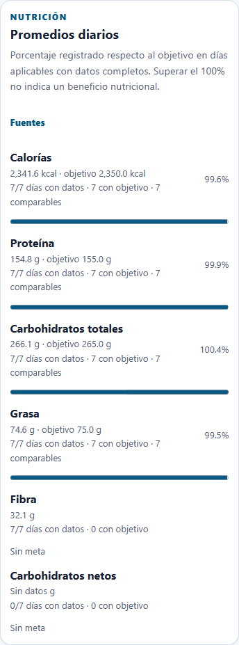
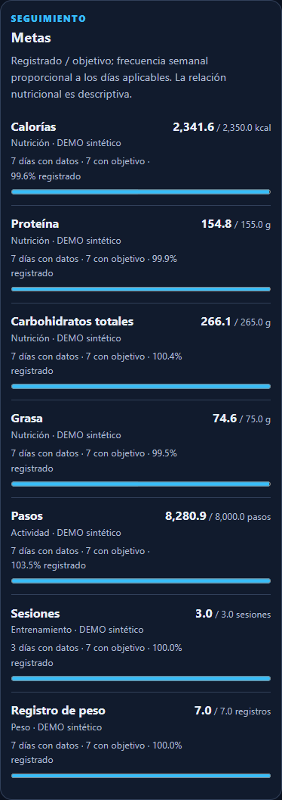

# Evidencia QA de carbohidratos y metas DEMO

Todos los registros mostrados son **ficticios**. Se generaron en una base aislada mediante los servicios reales de Health Tracker, con la fuente pública USDA filtrada a los 16 alimentos de la DEMO.

- [Diagnóstico, comportamiento y procedimiento del NAS](../../docs/DEMO_CARBS_GOALS.md).
- [MariaDB 11.4: historial, metas, integridad y carreras RC/RR](qa/mariadb.json).
- [Navegador: 12 combinaciones de ancho/tema](qa/browser.json).

Los artefactos se producen con `scripts/nutrition/qa_demo_carbs_goals.py` y `scripts/nutrition/ui_qa_demo_carbs_goals.cjs`. La aceptación fija el commit confiable de historia #47 indicado en el informe, sin incorporarlo a esta rama. No constituyen evidencia de un despliegue ni de escrituras en el NAS.
