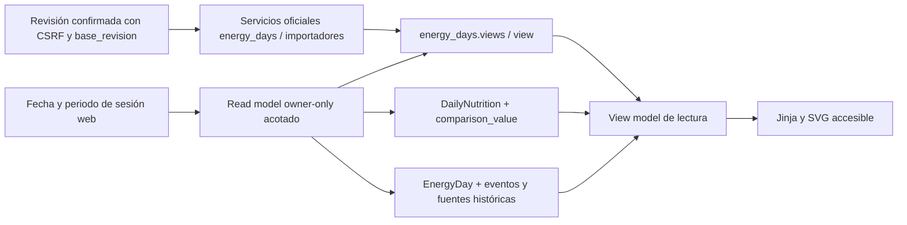

# Energy Experience 2.0 — propuesta para revisión

Estado: **dirección de diseño aprobada; entrega A en implementación para revisión**, sin despliegue. Rama local `feature/energy-experience-2-0`, creada después del cierre productivo del [issue #18](https://github.com/Donbumo/health-tracker/issues/18). Base desplegada: `9e2f2dc7fea728bfec3c8abf1aed6bc7bb428852`, migración 0046.

[Prototipo interactivo](../design/energy-experience-2-0/index.html) · [Capturas y QA](../design/energy-experience-2-0/README.md) · [Cierre productivo del hotfix](https://github.com/Donbumo/health-tracker/issues/18).

## Objetivo de producto

### Contrato visual revisado para A

- **Gasto total protagonista:** primera cifra y primera gráfica de ancho completo. Ingesta y balance son contexto con la misma semántica de Nutrition 2.1. Segunda sección de tendencias: total, activas, reposo, pasos y distancia, sólo con valores o medias conocidos; cada observación presenta unidad y fuente. No sumar componentes ni inferir gasto.
- **Barras diarias y línea de media móvil:** cero conocido visible sobre el eje; huecos y conflictos con símbolos distintos, subtotal parcial separado. Cada media usa sólo observaciones conocidas de los siete días naturales y muestra n/7; calentamiento de seis días. Cobertura no equivale a exactitud. Balance con ambos signos y eje cero. Tabla equivalente accesible.
- **Calendario dinámico:** mes de la fecha seleccionada, anterior/siguiente entre meses y años; días conocidos, cero, parciales, vacíos o en conflicto. Hoy usa zona efectiva de cuenta y fallback APP_TIMEZONE (UTC predeterminado); fechas históricas no se reinterpretan. GET sólo lee.
- **Historial reservado a B:** filtros combinables por fecha desde/hasta, fuente exacta y tipo de evento; orden estable por fecha de evento e identidad interna sólo en servidor; páginas de 25, sin descargar el historial completo, con filtros en los enlaces y ningún tope total silencioso. Fuente retirada visible como histórica, fuera del canónico. Original resuelto owner-only, autorización repetida y hash comprobado antes de descargar; sin IDs/payloads crudos visibles. El prototipo demuestra filtros/páginas con fixtures, no implementa endpoints de B ni promete acceso a originales.

La entrega A añade consulta `/energy` y conserva `/daily-energy` como regreso explícito a la interfaz actual, junto con las acciones legacy. No incluye historial nuevo, revisión guiada, importadores ni escrituras nuevas. No cambia schemas, contratos, flags o migraciones.

Poder responder desde una sola entrada: qué se conoce del día, de dónde viene, qué requiere revisión y cómo cambia a lo largo del tiempo. Consultar hoy vacío debe mostrar un enlace explícito al último registro con una cifra útil, sin presentarlo como dato de hoy. Elegir una fecha nunca modifica registros.

La nueva experiencia debe reutilizar el canónico y las decisiones existentes. No propone otro modelo de energía, nuevos cálculos de necesidades, un catálogo distinto, estimaciones desde pasos ni cambios de contratos móviles.

## Auditoría de la experiencia actual

Auditoría de rutas, servicios y plantillas del SHA desplegado; la validación productiva del hotfix se documenta por separado. No se capturaron cuentas reales ni se usaron datos personales en el prototipo.

| Área | Energía actual | Nutrition 2.1 | Dirección propuesta |
| --- | --- | --- | --- |
| Entrada | `/daily-energy`: tabla de todos los días canónicos, acciones manual/JSON; consulta sin paginar | Fecha, último registro, resúmenes y gráficas longitudinales | Resumen diario compacto; conservar acceso al listado |
| Hoy vacío | Listado histórico sin un estado diario contextual | Último día disponible visible fuera del rango seleccionado | Fecha de hoy explícita y último registro con contexto |
| Calendario | No hay calendario propio en Energía | Calendario y resúmenes por periodo | Disponibilidad por campo y acceso al día, incluidos conflictos |
| Tendencias | Gasto/balance ya se usan en Nutrición y dashboard, pero no en el listado de Energía | Tres gráficas con medias móviles, parciales y huecos | Reutilizar ese cálculo; ingesta, gasto y balance visibles |
| Detalle | Totales/actividad, conflicto y fuentes activas dentro de desplegables | Presentación integrada del día y comidas | Jerarquía de lectura; procedencia separada de la cifra canónica |
| Revisión | Formularios owner-only con CSRF y revisión, confirmación de vaciados/borrado | Revisión explícita de identidad y cantidad | Mantener los formularios/servicios; presentar pendientes por campo |
| Importación | JSON directo y flujos de Import Hub/CSV/estándar | Identificación → composición → declaración → confirmación | Archivo → preview → revisión → confirmación, sin otro parser |
| Historial | Eventos y tombstones ya persisten; la vista canónica omite retirados y días eliminados | Snapshots y recibos de importación | Lectura auditable de retirados, sin activarlos |
| Exportación | Cuenta JSON 1.1/ZIP verificados; CSV resume. El diario usa la proyección seleccionada | Export/restore de snapshots y originales | Explicar alcance; probar retirados antes de prometer historial completo en export diario |
| Móvil | UUID, revisiones y eventos por fuente; pasos no son gasto | Contratos vigentes, smoke físico separado | Compatibilidad intacta; no convertir este diseño web en cambio de API móvil |

Fuentes principales: `backend/app/wellness/routes.py`, `templates/wellness/energy_list.html`, `energy_detail.html`, `energy_edit.html`, `energy_delete.html`; servicios `energy_days.py`, `daily_balance.py`, `nutrition_history.py`, `dashboard/nutrition.py`, `real_file_imports.py`, exportadores y backups. Comparación Nutrition: `app/nutrition/routes.py` y `templates/nutrition/experience.html`.

Hallazgos que debe resolver la implementación:

- `energy_days.views` permite rango, pero el listado actual obtiene todo el historial. Añadir consultas acotadas y paginación visible; no otro límite silencioso.
- `view()` devuelve `None` para un día eliminado y `project()` contiene evidencias activas. Historial de retirados requiere una lectura owner-only explícita de registro/eventos; no cambiar la proyección activa ni llamar a restauración desde GET.
- El detalle muestra un identificador técnico de archivo. La nueva interfaz debe presentar nombre, fecha, tipo y acción segura de acceso, sin IDs DB ni rutas internas.
- Los balances deben usar `comparison_value` para ingesta y el campo canónico de gasto. Leer directamente `DailyNutrition.calories` ignoraría la parcialidad.
- Homogeneizar el concepto de «hoy» con la zona efectiva del usuario y fallback documentado. No desplazar fechas históricas ni reinterpretar sus orígenes por un cambio de zona horaria.

## Arquitectura de información

Una sola entrada visible, compatible con las URLs actuales:

1. **Resumen:** fecha, estado por campo, ingesta/gasto/balance, actividad, fuentes resumidas, tres gráficas y media móvil visible. Periodos 7/30/90 días.
2. **Calendario:** selección de fecha y leyenda textual: gasto conocido, parcial, conflicto o sin datos. Los indicadores hablan de disponibilidad, no de precisión ni de cumplimiento nutricional.
3. **Fuentes:** originales por origen, valores actuales y decisiones del día. Pendientes por campo; retirados en un bloque histórico explícito. No prioridad implícita por nombre de dispositivo.
4. **Importar:** reutilizar Import Hub y sus capacidades vigentes; no prometer formatos o dispositivos no soportados. Mismo plan firmado, validación repetida, confirmación y servicio oficial.
5. **Historial:** eventos de importación, revisión y retirada, filtros y paginación; originales y decisiones permanecen separados. Un backup anterior no deshace una decisión posterior.

En mobile, marca compacta, fecha y datos útiles antes de la navegación secundaria. Los controles permanecen disponibles; las gráficas no se ocultan en un acordeón. En escritorio, gasto a ancho completo y contexto de ingesta/balance en paralelo; tendencias y paneles de actividad/procedencia independientes. El prototipo ilustra el contenido; la implementación usará la navegación y tokens existentes de Flask.

## Semántica visible y cálculo

| Estado del campo | Presentación | Balance/media |
| --- | --- | --- |
| Conocido, incluido cero | Número y unidad; cero nunca se convierte en guion | Puede participar si ambos componentes son comparables |
| Parcial de ingesta | «Subtotal conocido · ingesta parcial», marcador separado | No participa como ingesta completa en balance/media comparable |
| Ausente/desconocido | Guion con motivo; no rellenar con cero | Hueco en la serie diaria |
| En conflicto | «Conflicto pendiente», campo y número de pendientes | Desconocido hasta resolución explícita |
| Fuente retirada | Fuera de los valores actuales; visible en historial | No se suma ni se reactiva automáticamente |

La cobertura se expresa como **n de N días con dato conocido** y denominador de balance comparable. No significa exactitud del dispositivo, días nutricionalmente completos ni cumplimiento de una referencia. Las medias móviles pueden existir durante un hueco de observación: son medias de observaciones previas y deben mantener su denominador visible.

No sumar totales entre fuentes. No deducir gasto de pasos ni total de activas + reposo. El balance conserva signo y sólo existe cuando ingesta comparable y gasto conocido corresponden al mismo día. La gráfica de balance necesita eje cero visible y admite ambos signos.

## Arquitectura técnica propuesta

No hace falta otra migración para la primera entrega. Reutilizar 0046:

- La fachada `backend/app/services/energy_history.py` compone `nutrition_history.history`, `mean` y `energy_days.views/view`. Reutiliza sin cambios ingesta, balance y medias de Nutrition; únicamente calcula geometría de barras y medias de campos de actividad con la misma función `mean`. No modifica servicios de persistencia. La composición conserva algunas lecturas auxiliares de Nutrition acotadas por fecha; optimizarlas requeriría otro cambio justificado y medido.
- Rango de gráficas acotado y seis días de warm-up para media de siete. Último registro mediante consulta independiente, incluso fuera del rango. Agregación por día canónico, jamás por fila de evidencia.
- Historial de eventos con orden estable, filtro owner-only y paginación visible. Las referencias de archivo deben volver a verificarse con propietario efectivo y SHA. Nunca devolver payload crudo a un listado.
- GET sólo lee: no registrar días inexistentes, seedear fuentes, crear resoluciones ni escribir eventos al consultar calendario. No confiar en `user_id` del cliente.
- Mutaciones conservan `lock_owner`, revisión canónica, controles de identidad/fecha destino, CSRF y confirmación explícita. Un preview obsoleto requiere volver a revisar; no reintentar escrituras automáticamente.
- Mantener `DailyEnergy` como evidencia/identidad móvil, `EnergyDay` como canónico y `EnergyEvidenceEvent` como auditoría. No fusionar filas, regenerar UUID ni sustituir revisiones históricas.
- Export completo de cuenta/ZIP sigue con su contrato probado. Para export diario, revisar y probar alcance con fuentes retiradas y día eliminado; ampliar el bundle existente sólo si hace falta, de forma compatible, antes de rotularlo «historial completo». No nuevo formato público.
- Flask/Jinja, CSS con alcance de página y SVG/JavaScript progresivo. Formularios funcionales sin JS; no SPA ni dependencia nueva. Tabla alternativa accesible para gráficas en la implementación.
- No modificar schemas Android/iOS, políticas de snapshots, catálogo, flags productivos ni importadores por conveniencia visual. Cualquier gate de exposición de la nueva UI se propondrá con default desactivado en su PR, sin tocar producción ahora.

## Revisión e importación

Resolución: elegir origen o valor explícito → revisar fecha/campo/cantidad → confirmar con revisión vigente. Conservar ambos valores originales. El prototipo implementa elección de origen como demostración; el valor manual, vaciado explícito y cambio de fecha siguen disponibles en los formularios existentes y se integrarán sin perder validaciones.

Importación: identificar archivo/origen → preview read-only con unidades y operación por campo → revisión de pendientes → confirmación atómica. Un parcial no borra datos. Un replay se presenta como «ya registrado» sin generar otra evidencia ni otra suma. Una contradicción se conserva para revisión; no elegir silenciosamente el último archivo. Errores muestran qué corregir y mantienen el original según la política existente.

La retirada se conserva como confirmación separada del día o de una fuente. Mostrar consecuencias y referencias antes del POST. No diseñar un botón de deshacer que resucite tombstones sin una política específica aprobada.

## Entregas incrementales propuestas

| Entrega | Alcance | Gate antes de avanzar |
| --- | --- | --- |
| A — consulta | Resumen, fecha/último, calendario, gráficas y medias; lectura sobre el canónico | Comparar balance/series con Nutrición y legacy; cero escrituras por GET; rendimiento con historial largo |
| B — procedencia | Fuentes activas/retiradas e historial paginado; acceso seguro a originales | Ownership de fuentes/archivos/eventos, no payloads ni IDs internos visibles; eliminados no resucitan |
| C — revisión guiada | Presentación de pendientes y preview de importación; conservar formularios y servicios | CSRF, revisión obsoleta 409, preview cambiado, cantidades/unidades, rollback atómico y replay en RC/RR |
| D — cierre visual | Accesibilidad, responsive, export claramente rotulado, rutas antiguas compatibles | Dark/light, teclado, seis anchos, sin overflow; regresión export/restore y compatibilidad móvil |

Cada entrega mediante PR separado y revisión focal. No repetir diseño del canónico ni 0046. No integrar/desplegar ninguna entrega sin su revisión. Si se identifica una necesidad de schema/contrato adicional, documentarla como decisión nueva, sin introducirla dentro del trabajo visual.

## Aceptación para implementación posterior

- Casos sintéticos: legacy conocido, fuente parcial complementaria, dos totales iguales, contradicción sin resolver/resuelta, cero, huecos, hoy vacío con último fuera del rango, fuente y día retirados, revisión posterior y replay antiguo.
- Una representación por fecha; números, balances y ventanas iguales en Energía/Nutrición/dashboard. Los subtotales no aparecen como déficits confirmados.
- Rangos 7/30/90 + warm-up; listado/historial con más de 100 entradas accesibles mediante paginación, sin tope silencioso. No descargar todo el historial al cliente.
- Móvil 360/390/430 y escritorio/tablet 768/1024/1366, dark/light. Tab, flechas de pestañas, foco visible, fecha nativa, radio/checkbox y Escape de diálogo. Acciones táctiles ≥44 px; inputs reales ≥16 px.
- JSON 1.0 de entrada y 1.1/ZIP de cuenta preservados; snapshots, hashes/eventos, UUID y revisiones owner-only. Sin cambios obligatorios Android/iOS. Smoke físico se mantiene como gate separado.

## Evidencia de esta propuesta

Prototipo autónomo con datos ficticios de enero/febrero de 2040; abre desde archivo, sin servidor, credenciales ni conexión a NAS/DB. Interacciones sólo en memoria: fecha/periodo, temas, calendario, fuentes, revisión con confirmación, importación por pasos e historial. No es Flask productivo ni un nuevo importador.

**60 combinaciones PASS**, seis anchos × dos temas × cinco vistas; 10 capturas, cero requests externos, cero errores JS, teclado y ausencia de overflow. Gráficas con huecos, subtotal parcial separado, balance con signo y medias visibles; flujo no cambia los datos ficticios hasta confirmar. Se revisaron visualmente Resumen mobile dark, escritorio light, fuentes y revisión mobile light. Resultados en `design/energy-experience-2-0/qa/report.json`.

Esta evidencia valida el prototipo. No acredita implementación del rediseño, pruebas de nuevos endpoints Flask ni dispositivos físicos. Producción sigue ejecutando exclusivamente el hotfix aprobado.

## Decisiones para revisión

La dirección y sus cuatro correcciones están aprobadas; A se entrega para revisión antes de integrar. B/C permanecen fuera de este PR. Quedan para confirmar antes de B/C el alcance del export diario completo, la presentación de un día retirado y cualquier política de restauración explícita. No condicionan ni revierten el cierre productivo del hotfix #18.

## Entrega A implementada para revisión

`/energy` es la entrada de navegación; `/daily-energy` sigue disponible mediante «Volver a interfaz actual». Rutas de detalle, captura, importación, edición, eliminación y exportación intactas. La única ruta nueva es GET autenticado; parámetros de fecha/período validados y propietario tomado de la sesión. No hay una API pública nueva, migración ni flag nuevo. No se activa ninguna función en producción con esta entrega.

Consulta acotada a 7/30/90 días, seis de calentamiento, mes seleccionado y consulta independiente de última fecha activa (MAX owner-only, sin cargar todo el historial). Las fuentes retiradas/días eliminados quedan fuera de observaciones y medias. Actividad sólo en valores canónicos conocidos; discrepancias no se eligen ni suman. Las tablas por gráfica exponen valor, estado, unidad, fuente y denominador; funcionan sin JavaScript.

El prototipo conserva las cinco áreas de diseño y demuestra filtros/paginación locales. Flask A implementa únicamente consulta, calendario y enlaces a acciones existentes. No incluye flujos nuevos de Fuentes/Historial/Importar de B/C. Comparación y evidencia real: [ENERGY_EXPERIENCE_2_0_A_QA.md](ENERGY_EXPERIENCE_2_0_A_QA.md).
