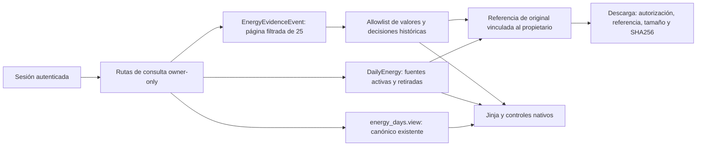

# Energy Experience 2.0 B — fuentes y auditoría para revisión

Rama `feature/energy-experience-2-0-b`, nacida de master `9624142901c191ebc5dd47f333a42f5096e9065e` **después** del [cierre productivo de A](ENERGY_EXPERIENCE_2_0_A_PRODUCTION.md). B está implementada para PR; **no fusionada ni desplegada**. NAS sigue ejecutando exclusivamente la imagen aprobada de A.

## Alcance de consulta

- `/energy/sources?date=…`: canónico actual o día retirado, decisiones conservadas, valores por fuente activa/retirada y revisión. Las fuentes no se suman. Contradicciones por campo muestran los valores pendientes sin escogerlos.
- `/energy/history`: auditoría de eventos, propuestas no aplicadas, valores conservados y revisión anterior, decisiones confirmadas/vaciados y fechas anteriores de registros movidos. Sólo allowlists de métricas; sin notas, payloads crudos, rutas, hashes ni IDs DB visibles.
- Filtros combinables de día desde/hasta, origen histórico exacto y operación. Sin fechas se recorre todo el historial propio. Fechas filtran el día asignado al evento; sus timestamps se muestran explícitamente en UTC.
- Páginas de **25 eventos**, `COUNT` y `LIMIT/OFFSET` en servidor, orden estable `created_at DESC, id DESC`; navegación conserva filtros. No se descarga todo el historial ni se impone un máximo total de 100. Una página fuera del final se normaliza al último resultado; filtros inválidos dan 400.
- Navegación resumen ↔ fuentes ↔ historial ↔ acciones existentes. Día retirado sigue consultable, sin restauración ni formulario nuevo de escritura. Una decisión de día puede figurar en varios eventos por fuente: son auditoría, nunca gasto adicional.

## Arquitectura e integridad

`energy_provenance.py` es exclusivamente una fachada de lectura sobre DailyEnergy, EnergyDay, EnergyEvidenceEvent y UploadedFile. Propietario efectivo desde sesión. Sin migraciones, tablas nuevas, cambios de modelos, enriquecimiento retrospectivo o reglas nuevas de reconciliación.

El origen de un evento procede de su snapshot, no del nombre actual de DailyEnergy. Si falta, se presenta «Origen no disponible»; no se inventa. En QA MariaDB se detectó que cruzar UUID de tablas legacy/0046 podía mezclar collations distintas. Se eliminó ese cruce innecesario: la identidad histórica sale directamente del JSON del evento. No se cambió ninguna collation ni se hizo DDL.

Eventos anteriores a la introducción de la auditoría no se fabrican. Las fuentes legacy siguen visibles aunque no exista un evento correspondiente. Los listados de originales sólo comprueban referencia/metadata; el contenido se verifica de nuevo al descargar.

## Originales protegidos

La descarga es **POST de lectura** `/energy/original`, con CSRF y referencia firmada en el cuerpo, para evitar referencias firmadas en URLs de access logs. No crea registros ni usa un importador/generador. El usuario sólo pulsa «Descargar original»; no hay confirmación adicional ni JavaScript obligatorio.

Controles al descargar:

1. Sesión, firma/expiración de 15 minutos, propietario efectivo y vínculo exacto del registro/evento al archivo. La referencia queda ligada al archivo y a su hash mediante HMAC; no contiene el hash del archivo en claro.
2. Fuente/evento y UploadedFile consultados otra vez con owner. Si se conserva hash histórico, debe coincidir con el del archivo. Si una evidencia legacy no lo registró, se verifica el hash actual del UploadedFile y se advierte esa limitación, sin rellenar su historia.
3. Path gestionado dentro del área de storage de ese propietario; rechazo de traversal, archivo de otro owner y cada componente symlink. Reutiliza el resolver oficial y verifica tamaño y SHA256.
4. Verificación del descriptor realmente servido para impedir que un cambio después de resolver el path entregue otros bytes. Respuesta attachment, nombre saneado, octet-stream, `nosniff`, `private, no-store`.

Token ajeno/alterado/caducado, vínculo cambiado, archivo ausente o integridad inválida: 404 genérico. Los originales permanecen accesibles después de una retirada o eliminación del día, siempre que el vínculo y el archivo conservados sean verificables. Varios archivos de una misma evidencia se recorren mediante sus eventos; no se sustituyen por el primer archivo del día.

No se cambian los UUID/revisiones móviles, snapshots, catálogo, nutrición, export/restore ni escritores existentes. Los formularios legacy de edición/borrado/importación mantienen sus servicios y confirmaciones.

## Validación final

| Gate | Resultado |
| --- | --- |
| Focal B y regresión A/canónico/balance/export/restore, Windows | **70 PASS, 1 skipped**; skip de creación de symlink por plataforma |
| Focal B Linux, Python 3.12 | **29 PASS**, incluido symlink real; [JUnit](../design/energy-experience-2-0-b/qa/linux-focal.xml) |
| MariaDB LOCAL QA 0046 | **RC/RR PASS**, [reporte](../design/energy-experience-2-0-b/qa/mariadb.json) |
| Paginación MariaDB | 117 eventos por propietario sintético; cinco páginas: 25/25/25/25/17, filtros combinados PASS |
| Ownership e integridad | Archivos distintos, dos owners, referencia ajena/alterada/caducada, hash/tamaño/metadata cambiados, traversal/symlink y swap después del resolver: PASS |
| Historial | Propuesta conservada sin reescribir original, decisión confirmada, fecha movida, retirada y día eliminado; sin resurrección ni doble conteo |
| Consulta y descarga sin DML | Sentencias instrumentadas y estado de canónico/evidencias/revisiones/eventos idéntico; sin backfill de hash legacy |
| UI Flask real | **48/48**, seis anchos × dos temas × cuatro vistas; **20 capturas**, [reporte](../design/energy-experience-2-0-b/qa/report.json) |
| Flujos HTTP | Login real de dos usuarios; original ajeno 404 con CSRF válido; filtros combinados, página 5, originales y navegación canónica PASS |
| Teclado/layout | Tab, foco, fecha nativa/selects/details, sin overflow; cero errores JS/HTTP inesperados |
| Otros | compileall, Compose config, git diff --check y db check en RC/RR PASS |

No se repitió la suite completa de A ya aprobada. Se ejecutó la regresión focal del área modificada. B usó únicamente fixtures ficticias y QA local; no se ejecutó código B en NAS ni sobre cuentas reales.

## Capturas y reproducción

Revisión visual manual: fuentes mobile dark, historial mobile light con propuesta, decisión desktop light, día retirado desktop dark y descarga de original mobile dark. Todas son Flask real con datos ficticios, no prototipo ni cuentas productivas.

| Vista | Mobile 390 | Desktop 1366 |
| --- | --- | --- |
| Fuentes | [Dark](../design/energy-experience-2-0-b/qa/sources-dark-390.png) · [Light](../design/energy-experience-2-0-b/qa/sources-light-390.png) | [Dark](../design/energy-experience-2-0-b/qa/sources-dark-1366.png) · [Light](../design/energy-experience-2-0-b/qa/sources-light-1366.png) |
| Historial | [Dark](../design/energy-experience-2-0-b/qa/history-dark-390.png) · [Light](../design/energy-experience-2-0-b/qa/history-light-390.png) | [Dark](../design/energy-experience-2-0-b/qa/history-dark-1366.png) · [Light](../design/energy-experience-2-0-b/qa/history-light-1366.png) |
| Decisiones | [Dark](../design/energy-experience-2-0-b/qa/decision-dark-390.png) · [Light](../design/energy-experience-2-0-b/qa/decision-light-390.png) | [Dark](../design/energy-experience-2-0-b/qa/decision-dark-1366.png) · [Light](../design/energy-experience-2-0-b/qa/decision-light-1366.png) |
| Día retirado | [Dark](../design/energy-experience-2-0-b/qa/retired-day-dark-390.png) · [Light](../design/energy-experience-2-0-b/qa/retired-day-light-390.png) | [Dark](../design/energy-experience-2-0-b/qa/retired-day-dark-1366.png) · [Light](../design/energy-experience-2-0-b/qa/retired-day-light-1366.png) |
| Original verificado | [Dark](../design/energy-experience-2-0-b/qa/original-dark-390.png) · [Light](../design/energy-experience-2-0-b/qa/original-light-390.png) | [Dark](../design/energy-experience-2-0-b/qa/original-dark-1366.png) · [Light](../design/energy-experience-2-0-b/qa/original-light-1366.png) |

Las capturas de originales conservan el scroll hasta el botón; las demás son primer viewport. Iniciar `scripts/energy/provenance_qa_app.py` con la venv existente y pasar su URL loopback como `ENERGY_QA_URL` a `scripts/energy/provenance_ui_qa.cjs` (Node/Playwright/Edge existentes). El runner `provenance_container_qa.py` usa wheels pytest offline en una venv temporal y la MariaDB LOCAL QA; exige conexión privada externa, schemas/scripts RO y salida de evidencia aislada. Nunca abrir `.env` ni usar producción para reproducir.

## Riesgos y límites separados

- JSON de origen sin índice específico puede requerir escanear eventos del propietario al filtrar. Se probaron más de 100; no se afirma capacidad de carga productiva. No se añadió índice/migración para resolverlo sin revisión.
- Los valores históricos son los registrados, no una reconstrucción del estado completo para cualquier instante. La fuente actual y la decisión canónica se rotulan por separado.
- Legacy sin hash propio de evidencia: integridad actual del archivo comprobada, garantía histórica limitada y visible. Sin restauración automática de originales eliminados.
- **C** (revisión/importación guiada) fuera de este PR. **D** conserva navegación en fechas límite y auditoría integral de accesibilidad; el QA focal no equivale a certificación WCAG.
- Android/iOS físico y OFF externo siguen separados. **No merge ni despliegue de B sin revisión.** A permanece en su imagen aprobada.
