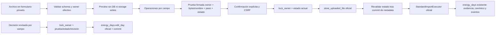

# Energy Experience 2.0 C — revisión e importación guiadas

Rama `feature/energy-experience-2-0-c`, creada desde master `6fdd594151f5ede12997b5447e28b10d4e8a901f` **después** del [cierre productivo de B](ENERGY_EXPERIENCE_2_0_B_PRODUCTION.md). C se presenta en PR separado: sin merge ni despliegue autorizado. NAS conserva B.

## Experiencia

`/energy/import` sustituye el acceso principal «Importar JSON» por cuatro pasos claros, manteniendo las rutas existentes disponibles:

1. Identificar archivo y origen. Seleccionar un JSON no importa ni almacena el original.
2. Revisar fecha, fuente, unidades y valores. Un resumen destaca los datos conocidos, incluidos ceros. Ausente/null es «Sin dato», no cero ni gasto confirmado.
3. Revisar operación por campo: conservar, añadir conocido, conservar propuesta contradictoria o añadir evidencia discrepante. Canónico pendiente, valor previo de esa fuente y valor del archivo aparecen separados. No hay elección silenciosa de último archivo.
4. Confirmar explícitamente fecha, fuente, unidades y operaciones con valores visibles. Sin checkbox o con estado cambiado, no se escribe energía.

Una contradicción importada queda conservada para decidir después. No se convierte en resolución automática. El enlace de fuentes abre `/energy/review?date=…` para revisar el día: conservar estado, elegir valor de una fuente activa, introducir valor manual validado o vaciar explícitamente. El paso siguiente muestra antes/resultado/operación; la confirmación final aplica sólo lo revisado. «Conservar» deja pendientes sin resolver y «Vaciar» no significa cero.

La revisión no cambia la fecha ni restaura días/fuentes retirados. El formulario completo anterior sigue accesible para sus acciones existentes; D conserva navegación en fechas extremas.

## Alcance de archivos y contratos

- La guía importa **una observación JSON 1.0**, hasta **256 KiB**, sin aliases ni formatos nuevos. El límite se anuncia antes de seleccionar, con enlace a la importación estándar existente para otros tamaños.
- JSON 1.1 exige `evidence` por contrato: representa identidades, revisiones, decisiones, eventos y retiradas, no una observación simple. Se valida/identifica y se remite a la importación estándar existente que utiliza el restore oficial de evidencias. **No se aplana ni se inventa un JSON 1.1 sin sus campos requeridos.** Los contratos y flujos 1.1/backup/restore anteriores permanecen intactos.
- No se crea un registro sin métricas conocidas. Un parcial de pasos o activas conserva ausencias; activas y reposo no se suman automáticamente para fabricar total.
- Archivo inválido, propietario ajeno, fuente vacía o tombstone se rechazan sin escrituras energéticas. No se reetiqueta una cuenta del archivo como si perteneciera al usuario actual.

## Arquitectura y transacción

`energy_guided.py` prepara lecturas y pruebas firmadas; no implementa un escritor de dominio nuevo. `guided_routes.py` orquesta los servicios oficiales. No se modifican `energy_days`, el executor estándar, modelos, migraciones, schemas ni contratos Android/iOS.

El original exacto viaja en un campo privado del formulario codificado en base64, sin almacenamiento previo, cookie ni URL. No se muestra JSON crudo en la interfaz. La prueba firma su huella junto al nombre, propietario, paso y fingerprint completo del día; no duplica el contenido en el token. No se confía en el `user_id` del cliente. Expiración 15 minutos; comprobar antes de avanzar y antes del commit. Formularios POST con CSRF; respuestas privadas `no-store`. No hay JavaScript obligatorio.

Los pasos 2/3/4 tienen pruebas distintas: no se salta de preview a confirmación cambiando un hidden. El preview, las operaciones o las fuentes obsoletas requieren volver a revisar (409). La autoridad de revisión sigue siendo el estado bloqueado del servicio 0046, no un contador cliente.

El servicio de archivos conserva su commit independiente existente. Después de guardar el original, se comprueba otra vez el estado bajo lock antes de llamar al executor. Éste conserva su verificación transaccional después del commit independiente de auditoría. Un fallo de dominio revierte canónico/evidencias/eventos completos; el original ya confirmado y la auditoría del intento quedan conservados y la UI lo advierte. No se promete un rollback físico de archivos ni se borra evidencia automáticamente.

Replay de la misma confirmación en sesión devuelve consulta sin repetir escritura. Otro preview/archivo idéntico reutiliza la deduplicación oficial; el escritor mantiene revisión, eventos y gasto sin duplicar. Fuera de la sesión original, una prueba obsoleta se rechaza; no reintenta automáticamente. Ninguna suma adicional de DailyEnergy sobre el balance legacy.

## QA final

| Gate | Resultado |
| --- | --- |
| C y regresión A/B/canónico/export/restore/balance Windows | 97 PASS, 1 skip de symlink por plataforma |
| Executor y web de importación estándar | 52 PASS |
| C focal final Windows | 27 PASS |
| C + originales protegidos B Linux Python 3.12 | 56 PASS; symlink incluido |
| MariaDB LOCAL QA 0046 | READ COMMITTED / REPEATABLE READ PASS; db check sin operaciones pendientes |
| Transacción | Preview sin writes; revisión obsoleta 409; rollback después de flush; original retenido para auditoría; gap del commit de archivo revalidado |
| Idempotencia y aislamiento | Cero vs unknown; archivo exacto/hash/tamaño; un evento; replay sin revisión extra; dos owners y 404; snapshots/orígenes intactos |
| JSON | 1.0 confirmado; 1.1 válido identificado y desviado sin aplanar; sintaxis, encoding, tamaño y contrato inválidos rechazados |
| Flask HTTP real | Matriz 84 combinaciones + 4 vistas de contradicción; 32 capturas dark/light, mobile 390 y desktop 1366 |
| Layout/teclado | Seis anchos 360/390/430/768/1024/1366; controles nativos, Tab/foco, sin overflow ni errores JS/HTTP inesperados |

Evidencia: [Linux JUnit](../design/energy-experience-2-0-c/qa/linux-focal.xml), [MariaDB RC/RR](../design/energy-experience-2-0-c/qa/mariadb.json), [Flask UI](../design/energy-experience-2-0-c/qa/report.json), [índice de capturas](../design/energy-experience-2-0-c/README.md).

Sólo fixtures ficticias en QA local. No se usó producción ni NAS para C. No se repitieron las suites completas ya aprobadas; se ejecutó la regresión afectada. Compilación, Compose config y diff check forman parte del cierre.

Reproducir: venv existente con `scripts/energy/guided_qa_app.py`; URL loopback impresa como `ENERGY_QA_URL` para `guided_ui_qa.cjs` con Playwright/Edge existentes. `guided_container_qa.py` usa imagen Python 3.12 existente, wheels offline, backend/schemas/scripts RO y salida QA; conexión privada externa sólo al schema QA LOCAL verificado antes de DML. No abrir `.env` ni apuntar a producción.

## Límites para revisión

- La guía no edita el contenido del archivo ni reconstruye JSON incompleto: corregir original o usar generador/importación existente. No es otro parser/importador.
- El formulario conserva datos propios codificados hasta confirmar; cerrar/cancelar descarta ese estado sin crear uploads. No se añade staging persistente ni una promesa de recuperación de borrador.
- Fuentes retiradas no son opciones de resolución. Propuestas pendientes se revisan explícitamente con sus valores; manual permite confirmar una propuesta que aún no es valor activo.
- JSON 1.1 e importaciones mayores siguen con el flujo estándar existente. No se rediseña restore en esta entrega.
- No certificación WCAG integral ni smoke físico Android/iOS. **D**: fechas extremas, accesibilidad y ajustes finales. OFF externo sigue separado.
- **No merge ni despliegue de C sin revisión.** B permanece en su imagen aprobada.
