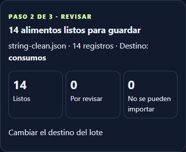
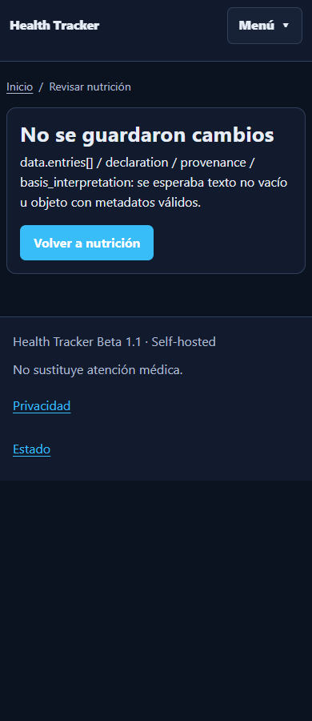

# Issue #40 · metadatos textuales de base 2.1

La procedencia canónica permite miembros editoriales arbitrarios. En el código productivo anterior, una anotación textual `basis_interpretation` llegaba a `_review_from_source().get('status')` y producía HTTP 500. El lector de calidad de `snapshot_summary()` también asumía que esa anotación era un objeto.

La reproducción usa exclusivamente un JSON inventado de **14 entradas** sobre las funciones del SHA productivo `4ed7d7620ea969ac0b4179bf7e40b8811b213a1d`: upload **500**, `AttributeError: 'str' object has no attribute 'get'`, y el mismo fallo en snapshots. Con las funciones corregidas: upload **302**, revisión **200**, 14 propuestas y cero escrituras de dominio. [Traceback sanitizado](../design/nutrition-basis-string/qa/reproduction.json).

## Comportamiento corregido

`nutrition_import_basis.source_interpretation()` valida la representación antes de que un lector use controles internos. Texto no vacío se conserva íntegramente como `source_annotation`, en estado propuesto y sin autoridad del propietario. No se impone un límite textual nuevo al schema; una nota larga o desconocida sigue visible, escapada, pendiente y sin contabilizar. Los objetos históricos válidos conservan su semántica; números, booleanos, listas, null presente y controles mal formados devuelven 422 con el campo legible, sin traceback.

Los lectores de revisión, preview, porciones, canonicalización, semántica legacy y reprocesado usan el mismo acceso validado. El lector de snapshots conserva texto editorial y calidad sin usarlo como consentimiento. Los controles editoriales recursivos se rechazan de forma acotada. El original no se transforma ni se pierde.

El reconocimiento de frases afirmativas es una allowlist de evidencia, incluida la declaración de nutrientes para la porción total declarada. **No interpreta «sin escalar» como una orden de cálculo**. El grupo exige original owner-only verificado, entrada idéntica, cantidad/base positivas e iguales en Decimal, misma unidad g/ml, vector válido, sin bindings o decisiones incompatibles ni contradicciones. Texto negado/desconocido, otra base o una corrección de cantidad queda pendiente. Una contradicción en otra nota tampoco se salta por una frase afirmativa.

La aceptación continúa por el POST oficial, casilla semántica separada, revisión optimista y auditoría existentes. No cambia cantidades, equivalencias, fórmulas, schema, modelos, migraciones ni dependencias. Los 30 nutrientes, calidad mixta/estimada y estados known/unknown/trace/below_limit conservan el tratamiento Decimal existente.

Los fallos transaccionales no dejan originales nuevos ni drafts parciales; una deduplicación fallida conserva el original anterior. Las comprobaciones de limpieza buscan archivos huérfanos, sin borrar carpetas de propietario que pueden contener otros originales.

## QA local ejecutada

| Gate | Resultado |
| --- | --- |
| SQLite: correctivo, 1.0/2.1, notas largas, preview, macros/micros, resumen diario y Unified Summary | **258 PASS**, 35 casos correctivos |
| MariaDB 11.4 tmpfs, 0046, READ COMMITTED | **104 PASS** + regresiones existentes |
| MariaDB 11.4 tmpfs, 0046, REPEATABLE READ | **104 PASS** + regresiones existentes |
| Regresiones por ambos perfiles | 18/21/23/51, notas 1999/2000/2001/5000, forks/TTL/recovery, owner/CSRF/revisión/firmas, replay/concurrencia/rollback y export/restore PASS; db check PASS |
| Edge/Playwright escritorio/móvil, seis anchuras y dos temas | **32 escenarios / 480 verificaciones**, cero errores JS |
| Estático | compileall, sintaxis JS, Compose sin leer `.env`, diff check PASS |

Diez escenarios nuevos de navegador cubren 14 textos válidos, contradicción, texto desconocido con HTML, cero/traza/límite/desconocido y 422; las regresiones de navegador añaden 22 escenarios. La fixture homogénea pasa a **14 listos / 0 pendientes / 0 inválidos** con un solo POST semántico; las excepciones conservan **13/1/0**. Los totales se cotejan con sumas Decimal independientes. Guardar todo y consentimiento final permanecen separados.

Las 35 pruebas correctivas de importación y el navegador no crean MealLog/FoodProduct/Receipt. Las regresiones del escritor y export/restore usan consentimiento y dominio **ficticios en bases desechables**. No se usó el archivo personal en QA, fixtures, capturas o CI. Estos resultados son locales, no una afirmación sobre CI.

## Diagnóstico privado y límite productivo

La inspección privada, sólo lectura, comprobó el archivo entregado: **14 anotaciones textuales, schema estricto válido, 30 tipos de nutrientes y 14 relaciones cantidad/base compatibles sin contradicciones detectadas**. La comparación con la variante retenida en el NAS confirmó paridad en nutrientes, cantidades/bases e identidad/comida de las 14 entradas; los objetos completos no son idénticos. Se verificó integridad de los originales, sin publicar nombres, fechas nutricionales, cifras, SHA, IDs o rutas privadas.

Los logs revisados mostraron el fallo en `_review_from_source`, sin otra clase de excepción independiente en esa ventana. El segundo lector se reprodujo con datos inventados. Peticiones HTTPS de healthz e importación autenticada se correlacionaron con los logs del contenedor principal, manteniendo TLS normal y sin alterar red/configuración.

**Producción sigue en `4ed7d7620ea969ac0b4179bf7e40b8811b213a1d`.** Los 34 drafts observados, incluidos los lotes de 18/21/23, y el dominio nutricional permanecieron intactos. Hubo tres uploads adicionales durante la observación; Codex no envió archivos ni POST de decisiones/confirmación productivos y no atribuye esos uploads al correctivo. El original local tampoco se modificó. Se preservaron 232 archivos locales previos.

**Ingeniería QA PASS · aceptación productiva pendiente de PM.** No se hizo squash, merge, despliegue, aceptación semántica real ni Guardar todo. #40 debe seguir abierto hasta el despliegue autorizado y la aceptación real del propietario. [Resultados agregados](../design/nutrition-basis-string/qa/results.json).
