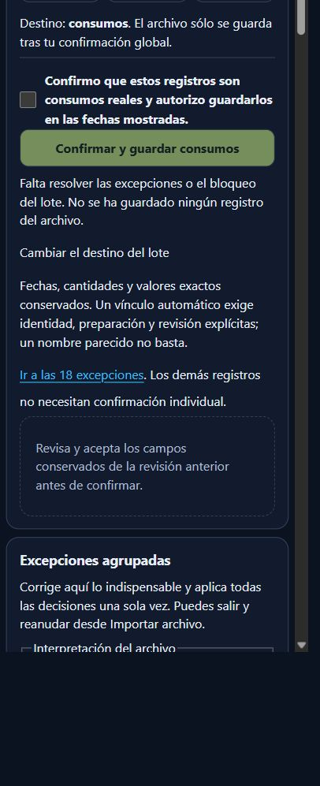
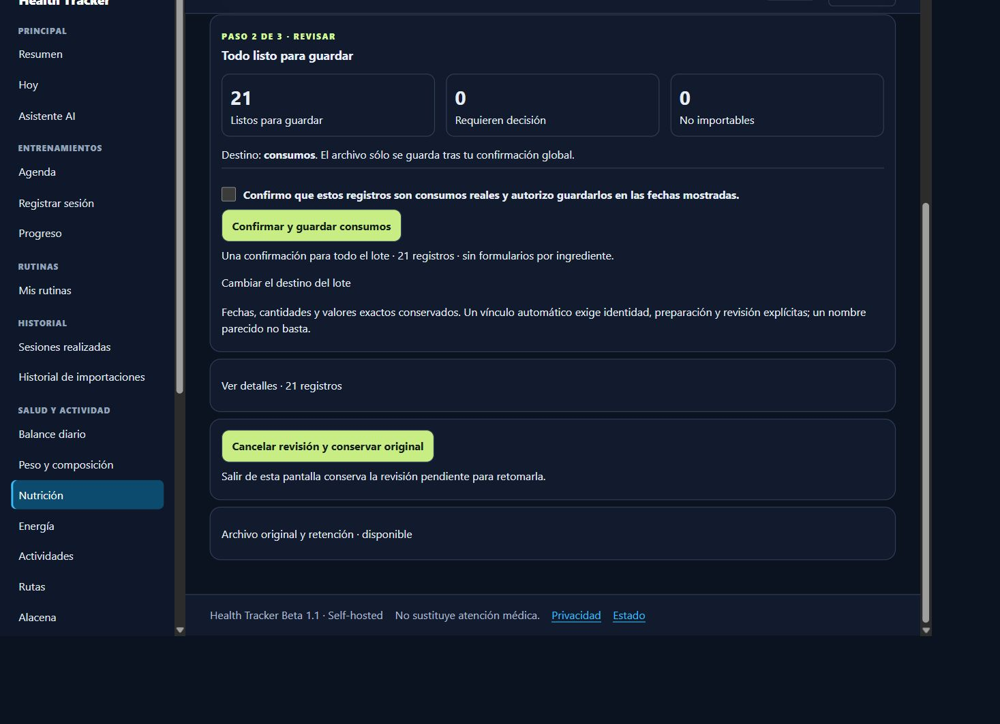
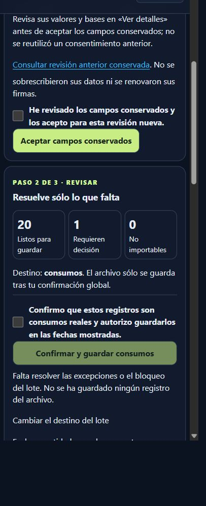
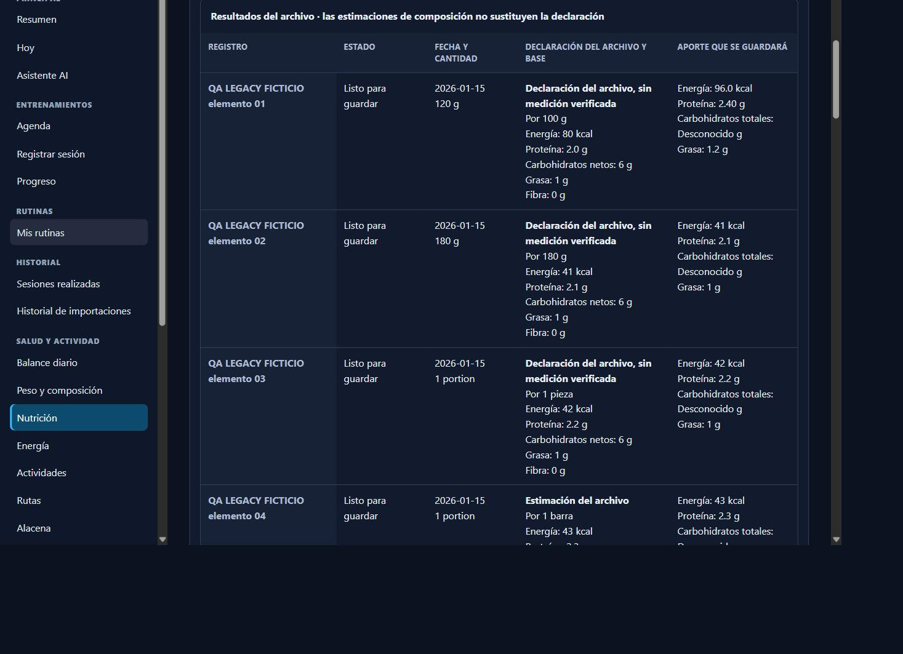

# Nutrition Import — contrato legacy diario y revisión agrupada

## Problema y alcance

Base: master `12bad71a60b96b57d282cfaf745fc0dc4ed27ab6` (PR #30 productivo). Rama `codex/nutrition-import-legacy-semantics`. Esta entrega corrige el contrato de extracción y revisión; no fusiona ni despliega, no añade migraciones, schemas, dependencias, escritores ni guardado parcial y no inicia Nutrition Intelligence C.

La aceptación productiva anterior detectó 21 registros, 1 listo/20 pendientes/0 no importables. Se conservaron original y revisiones; no hubo confirmación de consumos ni productos. Ese resultado es un fallo funcional, no una aceptación aprobada. Aquí se publican exclusivamente esos agregados autorizados. No se copió el archivo personal a QA, Git, logs o evidencias, ni se confirmó nada en producción. No se pudo reabrir la pestaña propietaria durante esta entrega y no se intentó suplantar la sesión; no hay una nueva medición productiva.

## Causa exacta

`json_rows` extraía `data.meals[].items[]` de `daily_nutrition`, pero sólo trasladaba cifras, cantidad y unidad. Perdía la semántica que ya implementan el schema 1.0, `importers/daily_nutrition.py`, el adaptador diario de StandardImportExecutor y el exportador diario: los campos nutricionales del elemento son sus aportes registrados; esos escritores no los multiplican por `quantity`.

Después de #30, la ruta `declared` exige base y cantidad suficientes para un consumo sin producto. El extractor no había establecido esa base para el formato diario. Las fixtures de #30 usaban bases explícitas y otra estructura: llegar a 21/0 con ellas no probaba este contrato.

Se añade un adaptador específico, read-only. Valida cada elemento en su envoltorio de origen contra `daily_nutrition.schema.json` (con la comida seleccionada, sin mezclar hijos ni importar los agregados diarios del padre). Un nombre de archivo, `record_type` aislado, notas, una coincidencia textual o la selección de destino nunca bastan como prueba del contrato.

## Correspondencia semántica

| Origen | Declaración propuesta/canónica | Consumo y snapshot |
| --- | --- | --- |
| A. Elemento válido del contrato diario 1.0 | Base propuesta = cantidad y unidad originales; aceptación agrupada explícita | Factor cantidad consumida/base original; con cantidades iguales es 1. Los nutrientes se cuentan una vez. |
| B. Base explícita o aliases consistentes por 100 g/ml | Conservar base 100 y unidad; conflictos o mezcla de bases quedan pendientes | Aplicar sólo cantidad/base. No convertir ml a g sin equivalencia verificada. |
| C. Base comercial explícita | Conservar cantidad de base y nombre de unidad nominal | Comparar etiquetas; misma unidad puede contarse sin inventar masa. Convertir a g/ml exige comprobación independiente. |
| D. Estimación con base suficiente | Cifra y estado originales; `quality=estimated`, `measurement_verified=false` en procedencia | Marcador `estimated_source_declaration` y etiqueta visible. Aceptar semántica no convierte una estimación en medición. |
| E. Fuente, base, cantidad o interpretación insuficiente/contradictoria | Propuesta visible, sin alternativa preseleccionada | Bloqueo hasta decisión consciente de total consumido, base por 100 g/ml o base exacta corregida. |

Los aliases externos permanecen en el normalizador; el documento final sigue siendo `nutrition_import` 2.1. Se mantienen separados valor, unidad nutricional, cantidad consumida, base, evidencia, calidad y aceptación. `original_values` conserva el original; `provenance.basis_interpretation` conserva contrato, propuesta y decisión. No se extraen números de notas como micronutrientes verificados.

`known` significa cifra declarada disponible en el vocabulario existente; no prueba que esté medida. La calidad estimada permanece en procedencia, en la tabla y en la fuente del resumen. No se crea un estado público nuevo. Los micronutrientes ausentes siguen desconocidos; trace, below_limit y cero realmente conocido se conservan. Si la nota describe explícitamente un cero de fibra como marcador de compatibilidad, se exige decidir desconocido o introducir un valor verificado; el cero original no se destruye.

Las comprobaciones textuales son conservadoras y limitadas: advierten ciertas afirmaciones de otra base y marcadores, no interpretan toda la prosa ni certifican fuentes. Una fuente no reconocida exige elección explícita. No se llama IA.

## Revisión y conservación

- “Interpretación del archivo” agrupa sólo totales respaldados por el contrato y con cantidad/base originales sin cambios. La casilla está desmarcada.
- Bases o cantidades corregidas anteriormente quedan fuera de la aceptación agrupada. La UI permite conservar la base original, afirmar total de la cantidad corregida o confirmar otra base exacta. No obliga a reescribir macros.
- Los formularios originales de catálogo/producto siguen disponibles como alternativa; ninguna identidad ni producto es obligatorio para una declaración suficiente.
- Nueva versión: `nutrition-legacy-semantics-v3`. Tanto #29 como #30 pueden reprocesar el original mediante un fork trazable; nunca se actualiza `review_json` de la revisión anterior en un GET.
- Se conservan nombre, fecha, cantidad, base y correcciones nutricionales compatibles; las firmas/consentimientos no se trasladan. Las equivalencias continúan sin verificar. La nueva revisión requiere aceptar campos heredados.
- Un vacío del parser anterior no borra una declaración recién reconocida, por ejemplo aliases por 100 ml. Se informa de esos campos nuevos en la aceptación de heredados. Un vector vacío con base o decisión nutricional explícitamente revisada sí se conserva vacío.
- Reprocesar de nuevo converge en la misma revisión independiente y no sobrescribe sus ediciones posteriores. Recibos existentes impiden un fork que pueda duplicar consumos.

No cambian autoridad del día, conflictos con historial, owner efectivo, CSRF, vigencia, firma, consentimiento global ni la transacción de StandardImportExecutor. La confirmación vuelve a validar contrato y plan. Un POST técnico sólo guarda revisión.

## Fixture que reproduce la estructura

[legacy-daily-semantic-21.json](../examples/qa/nutrition-import-ux/legacy-daily-semantic-21.json) es enteramente ficticia y tiene el envoltorio `schema_version/record_type/source_type/user_id/data/meals/items`: 21 elementos, 20 sin campos explícitos de base. Incluye g, ml, piezas, barras, botellas, sobres, porciones y cucharada nominal, estimaciones, nutrientes ausentes, base por 100 g/ml y dos excepciones reales. La variante [comercial](../examples/qa/nutrition-import-ux/legacy-commercial-basis.json) prueba base por lata sin masa inventada.

Los predecesores se generan ejecutando los blobs exactos del parser y servicio #29 (`1cf8d830ba801a8c8121cf594b07a0269a6d6e6f`) y #30 (`12bad71a60b96b57d282cfaf745fc0dc4ed27ab6`) con esta fixture. Un único vínculo QA previo reproduce 1 listo/20 pendientes. No hay datos personales ni dependencia de alimentos productivos.

## Resultados y métricas

| Estado/acción | Antes (#29/#30) | Nuevo, QA estructural |
| --- | --- | --- |
| Listos / decisiones / inválidos | 1 / 20 / 0 | 3 / 18 / 0 tras extracción |
| Interpretación respaldada agrupable | No disponible | 17 elementos con una casilla |
| Tras aceptación agrupada, sin resolver las dos excepciones | Sin terminar | 19 listos / 2 pendientes |
| Excepciones conscientes | Reconstrucción de declaraciones | Una semántica ambigua y un marcador de fibra; ninguna cifra reintroducida |
| Resultado tras esas decisiones | No se había logrado | 21 listos / 0 pendientes |
| Confirmación final | Bloqueada | Disponible tras aceptar heredados; consentimiento de consumo aún desmarcado |
| Productos necesarios | Flujo dirigía a identidades | 0 |
| Guardado ficticio y replay | — | 21 logs / 0 productos / 1 recibo por propietario |

En móvil y escritorio, desde la revisión anterior abierta: **4 activaciones de botón y 4 POST** (reprocesar, aplicar decisiones, aceptar heredados y confirmar sólo QA); **3 casillas** (interpretación, heredados y consumo QA) y **2 selects** para las excepciones. Total **9 interacciones**, sin contar navegación inicial, login, scroll o selector de archivo. Se combinan interpretación y excepciones en un único POST técnico. No se mide ni se inventa un porcentaje de reducción contra una ejecución anterior que no pudo terminar; sí se demuestra la eliminación de 20 reconstrucciones manuales de base/macros. Estos números no se atribuyen al archivo personal.

### Verificación focal

- SQLite: **131 casos focales validados** (19 semánticos revalidados al cierre y 112 restantes PASS en la tanda precedente); pruebas nuevas y existentes de imports, recuperación, porciones, micros, Nutrition 2.1/3.0; cantidades originales/corregidas, bases, notas contradictorias, ausencia de doble escalado, cero/trace/below_limit, estimación y export/restore semántico. Owner, CSRF, firma, consentimiento, revisión obsoleta, rollback después de flush e historial existente. GET de Nutrition, micros 7/30/90, biblioteca, Energy y dashboard sin DML/DDL.
- MariaDB aislada local: **RC y RR PASS**, Alembic **20261018_0046**, `db check` sin cambios. Ocho escenarios (#29/#30 × vigente/vencido × aislamiento), fork concurrente único, conservación, corrección de cantidad, confirmación y replay sin duplicación. [RC](../design/nutrition-import-legacy/qa/legacy-mariadb-READ_COMMITTED.json), [RR](../design/nutrition-import-legacy/qa/legacy-mariadb-REPEATABLE_READ.json).
- Con confirmación concurrente el perdedor puede recibir **409 con rollback** durante el hueco de auditoría; su reintento devuelve **200** y el recibo existente. No se promete que ambos intentos iniciales sean 200. Los datos y recibos siguen únicos.
- Flask real: móvil y escritorio PASS con usuarios ficticios. [Métricas](../design/nutrition-import-legacy/qa/browser.json). Anchos CSS medidos: 359, 391, 430, 768, 1023 y 1366 (objetivos 360/390/430/768/1024/1366, redondeo del navegador); sin overflow global. Capturas en tema oscuro; CSS de temas sin cambios. No se declara campaña general de accesibilidad ni una nueva validación visual clara.
- Compilación Python y Compose con valores exclusivamente ficticios: PASS; no se leyó `.env`. Sin schema/migración nuevos ni acceso al NAS.

La primera ejecución de MariaDB QA apuntó el upload root a una ruta distinta de `uploads/raw`; el gate de integridad lo bloqueó antes de crear el fork. Se corrigió el arnés, sin cambiar el contrato de storage. La fixture también detectó la pérdida de declaraciones vacías por el parser viejo; se corrigió el carry conservador y se añadieron pruebas.

La suite general se ejecutó una vez: **1502 PASS, 35 omitidos y 5 fallos iniciales**. Tres se resolvieron y revalidaron (handoff demasiado largo y dos fixtures FIT ausentes, generadas con el generador ficticio existente). Los otros dos corresponden a fixtures GPX/TCX/CSV de `test_real_file_imports` ausentes del checkout/master; no son regresiones de nutrición ni se fabrican para declarar verde una campaña ajena. No se afirma PASS global ni se repite toda esa suite. El resumen focal final queda en `checks.json`.

### Capturas Flask con datos ficticios

[Guardado móvil](../design/nutrition-import-legacy/qa/mobile-saved.jpg) · [guardado escritorio](../design/nutrition-import-legacy/qa/desktop-saved.jpg) · [estado anterior](../design/nutrition-import-legacy/qa/desktop-old.jpg).

## Reproducción

1. Ejecutar `backend/tests/test_nutrition_import_legacy_semantics.py` con el entorno de pruebas del proyecto y el resto de tests de importación focales. Los tests leen los blobs de Git sólo como código QA conocido.
2. MariaDB: crear un contenedor efímero local con schema **nutrition_legacy_qa**, aplicar migraciones hasta 0046 y montar backend/schemas/scripts/examples read-only. Materializar de Git los dos archivos de parser/servicio anteriores en `QA_PRIOR_CODE/29` y `/30`. Ejecutar `scripts/nutrition/mariadb_legacy_semantics_qa.py` con `QA_ISOLATION=READ COMMITTED` y `REPEATABLE READ`, y `/evidence` apuntando sólo a QA. El script rechaza otro schema.
3. Flask: ejecutar `scripts/nutrition/qa_legacy_semantics_ui.py` (loopback 8038, SQLite y storage temporales). Usar los usuarios ficticios `qa-semantic-mobile` y `qa-semantic-desktop`, contraseña ficticia `fictional-semantic-ui-password`. Abrir `/qa/legacy`, revisar, reprocesar, marcar interpretación agrupada, elegir total consumido en el elemento 11 y desconocido para fibra del 12. Aplicar una vez y aceptar heredados. Sólo en QA, confirmar consumo y comprobar `/qa/legacy`: 21 logs/0 productos/1 recibo/anterior intacta.

## Integración posterior y aceptación pendiente

Este PR debe revisarse antes de integrar. Tras aprobación: revalidar HEAD/base/protecciones, conservar imagen compatible, backup nuevo consistente DB/storage con checksum y restore aislado, validar 0046 y construir desde squash revisado. Recrear sólo web mediante Compose principal, mantener DB/volúmenes/configuración y verificar imagen realmente activa, smoke autenticado y GET sin DML. Recuperar sólo imagen compatible si falla un gate crítico; nunca un backup antiguo sobre escrituras nuevas.

Después del despliegue autorizado, abrir la revisión #30 del propietario y hacer fork con v3; conservar también #29 y aceptar sólo decisiones compatibles. Medir listos, ambigüedades verdaderas, comprobaciones de equivalencia y acciones reales. **No prometer 21/0 antes de esa aceptación ni guardar consumos personales sin consentimiento posterior expreso.**

## Cierre de revisión 5704011429 y diagnóstico privado anterior al merge

La aceptación ahora conserva una huella explícita de cantidad, unidad, base, etiquetas, tipo de interpretación y equivalencia utilizada. `sufficient`, el overview y la generación canónica rechazan una aceptación cuyo contexto ya no coincide. Los valores numéricamente iguales y los cambios de presentación no invalidan; cambios relevantes vuelven a propuesta y requieren decisión consciente. `source_total` mantiene la base original; `consumed_total` fija base a la cantidad actual; `per_100g/ml` fijan 100 en su unidad; `explicit_basis` conserva la base revisada. No se tratan como equivalentes.

La reproducción obligatoria con 121 g/41 kcal se prueba mediante POST consecutivos: aceptar consumed_total, editar a 180 g en otro POST, bloquear la aceptación obsoleta y confirmar de nuevo. El snapshot vuelve a 41 kcal, igual que el POST único explícito. Las pruebas repiten bases, unidades, etiquetas y equivalencia; las verificaciones de equivalencia se reinician si cambia su valor o unidad. Un documento canónico 2.1 conserva la procedencia histórica y vincula las ediciones a su representación normalizada, sin perder etiquetas de porción ni saltarse la invalidación.

La elegibilidad agrupada se calcula después de aplicar los cambios propuestos. Una fila corregida deja de ser agrupable, queda pendiente y las otras decisiones se guardan en el mismo POST técnico atómico. Navegador móvil/escritorio y MariaDB RC/RR verifican 20 listos/1 pendiente, después 21/0 al resolver sólo esa fila; no se reconstruye el resto. [Gate focal y métricas](../design/nutrition-import-legacy/qa/review-gates.json).

El extractor candidato se ejecutó en el NAS sobre una lectura privada del original seleccionado desde la sesión propietaria, antes del merge. Selección relacional en transacción READ ONLY, vínculo owner/revisión/upload, tamaño y SHA-256 verificados; contenedor sin red, raíz y storage read-only, SQL del extractor bloqueado. No se crearon borradores/recibos ni se modificó el original o revisiones. No se sacó contenido personal del NAS.

Agregados: 21 registros, 20 con semántica legacy respaldada por el contrato individual y 1 sin interpretación inequívoca; 18 agrupables, 6 con calidad estimada y 2 con marcadores sin verificar. No faltan campos de base después de la extracción/carry. La fuente completa tiene una infracción de maxLength en una descripción de unidad: no se relaja el schema ni se convierte esa fila automáticamente en conocida. Tras simular la aceptación sólo en memoria: 17 suficientes, 3 decisiones semánticas/de cantidad y un bloqueo adicional de marcador; otro marcador coincide con una de esas excepciones. El archivo real no es idéntico a la fixture y necesita revisión contextual: no se promete 21/0 sin esas decisiones. [Diagnóstico agregado](../design/nutrition-import-legacy/qa/private-format-aggregate.json).

Validación de revisión: 169 tests focales SQLite PASS (58 semánticos), ocho escenarios MariaDB 0046 RC/RR PASS con POST consecutivos, exclusión y persistencia; los tests afectados de importación/micros/Nutrition permanecen verdes. No se repitió la suite general. Se verificó contra master que el módulo de pruebas generales es idéntico y sus fixtures GPX/TCX/CSV ya están ausentes allí: [comparación de baseline](../design/nutrition-import-legacy/qa/general-suite-baseline.json).

El propietario autorizó cerrar revisión, squash e integración/despliegue controlados cuando pasen los gates. La aceptación personal posterior sigue limitada a decisiones técnicas: no marcar consentimiento, no POST `/confirm` y no crear MealLog, FoodProduct ni recibos. El informe productivo se conservará local y separado de estos resultados de código/QA.
