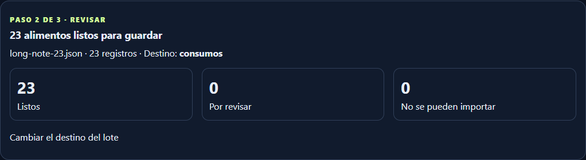
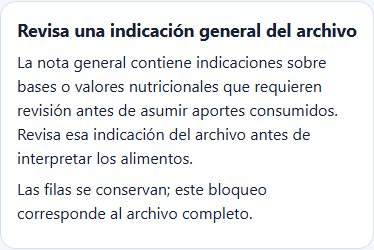

# Issue #34 · reconocimiento semántico con notas generales extensas

Base: `6ff1e9a1b43a4ec50431ef7afbf64f72784dcefc` (#33).
Rama: `codex/issue-34-legacy-note-semantics`. Sólo PR para revisión técnica;
sin merge, despliegue ni acceso al archivo o borrador personal durante desarrollo.

## Problema y comportamiento

El clasificador de `daily_nutrition` 1.0 validaba cada alimento dentro de una copia
del sobre original. Una nota general de más de 2.000 caracteres hacía fallar todas
esas validaciones; se perdía la propuesta de totales consumidos y se presentaban
N decisiones independientes de base.

El reconocimiento semántico admite ahora **exclusivamente** errores con path
`('data', 'notes')`, validator `maxLength` y límite exacto `2000`. Usa el validator
estricto existente y examina sus errores estructurados; no modifica el schema,
el documento, la nota ni `validate_json_document`. Cualquier otra infracción
sigue impidiendo esa inferencia para el candidato afectado. No se extiende a
`item.notes`, versiones desconocidas, campos extra, tipos ni requeridos.

El JSON original de entrada sigue siendo inválido para el importador estándar si
incumple ese máximo. En el asistido, el núcleo reconocido permite **proponer** una
interpretación agrupada, nunca aceptarla automáticamente. Tras la decisión
explícita se genera Nutrition Import 2.1, se valida y se usa el importador oficial.

Los bytes y SHA del upload permanecen intactos. Las notas generales completas se
conservan además en metadata owner-only del borrador, con texto escapado bajo
«Procedencia y avisos del archivo». El aviso de longitud es informativo; no exige
editar ni truncar la nota para registrar los alimentos mediante el flujo asistido.

## Notas contradictorias y límites

Se examina la nota general completa, tanto corta como larga. Se normalizan
mayúsculas y acentos para detectar expresiones de base por 100 g/ml, porción,
unidad/pieza/envase, bases distintas, negación de aportes consumidos, fibra como
marcador operativo y contradicción neto/total, con casos españoles e ingleses
probados. Una estimación general conserva su calidad de estimado. Son señales conservadoras, no un intérprete
universal de lenguaje natural ni instrucciones para inventar conversiones.

Una señal incompatible produce un **único bloqueo de archivo**, visible antes
de la lista. No se infiere una base total, no hay interpretación agrupada ni firma
de guardado. Los registros en espera del archivo no se cuentan como listos o como
N correcciones independientes. Las incidencias propias de una fila siguen visibles.
El bloqueo se aplica tanto en la revisión compacta como en el constructor canónico.
No se elimina con la interpretación agrupada ni mediante una marca de fila:
la contradicción del origen debe resolverse antes de una revisión guardable.

Los gates previos de notas de ítem, bases mixtas, porciones/equivalencias,
cantidades cambiadas, estimaciones, fibra operativa, total/neto y composición
continúan vigentes. Los micros ausentes siguen desconocidos; cero conocido se
conserva. El límite global de entrada sigue siendo 10 MiB y el máximo de 250 filas.

## Borradores v4

El extractor pasa a `nutrition-note-semantics-v5`. Un upload del mismo SHA no
descarta un borrador anterior ni fuerza extracción. Reprocesar usa el mecanismo
oficial desde el original verificado, con fork explícito de v4, vigente o vencido.

Se conservan owner, SHA, upload, revisión/TTL antiguos, decisiones compatibles,
correcciones y ediciones posteriores del fork. Repetir el reprocesado reutiliza el
fork vigente. No se trasladan firmas ni consentimientos; se mantiene la aceptación
separada de campos heredados y la interpretación de base pertinente.

## Evidencia ficticia reproducible

Fixtures de [nota editorial larga](../examples/qa/nutrition-note-semantics/long-note-23.json)
y [nota contradictoria](../examples/qa/nutrition-note-semantics/conflicting-note-23.json).
Todos sus nombres, fechas, cuentas, notas y nutrientes son ficticios.

| Fixture de 23 alimentos | #33 / v4 | v5 |
| --- | --- | --- |
| Nota editorial de 5.000 caracteres | Sin propuesta agrupada; 23 pendientes de base | 23 propuestas agrupables; un POST de interpretación → 23 listos / 0 pendientes |
| Nota con instrucción por 100 g | Sin inferencia segura | Un bloqueo de archivo; 0 errores de fila derivados de esa nota; guardado deshabilitado |

Los límites 1.999/2.000/2.001/5.000 se prueban con las mismas condiciones.
El código exacto de #33 se ejecuta con fixtures para el estado anterior y los forks;
no se atribuyen métricas ficticias a una nueva aceptación productiva.

Validación final: **307 SQLite focales PASS**, incluidas 41 pruebas nuevas;
MariaDB 0046 RC/RR PASS y `db check` sin operaciones nuevas. Se cubren owner,
CSRF, firma/consentimiento, revisión optimista, concurrencia/replay, rollback,
snapshots, export/restore y GET sin escrituras. SQLite/MariaDB cubren cuatro
límites de nota, seis contradicciones generales y forks v4 vigentes/vencidos.
Flask/Edge: diez escenarios, 72 comprobaciones de ancho/tema y teclado.

Suite general: **1.627 PASS, 35 skipped y un fallo preexistente** del handoff local
de 160 líneas frente al máximo de 80. Se conserva el documento y no se declara
PASS global. Compilación, Compose config sin `.env` y diff check PASS.

Ver [comparación v4/v5 ejecutada](../design/nutrition-note-semantics/qa/before-after.json),
[resultados agregados](../design/nutrition-note-semantics/qa/checks.json),
[MariaDB RC](../design/nutrition-note-semantics/qa/mariadb-READ_COMMITTED.json),
[RR](../design/nutrition-note-semantics/qa/mariadb-REPEATABLE_READ.json),
[navegador](../design/nutrition-note-semantics/qa/browser.json) y
[regresión visual #33](../design/nutrition-note-semantics/qa/regression-browser.json).

Reproducir desde raíz con el entorno del proyecto:

1. `python scripts/nutrition/qa_note_semantics_fixtures.py`.
2. Desde backend, `python -m pytest -q tests/test_nutrition_import_note_semantics.py`
   y las suites de regresión nutricional indicadas en el reporte.
3. MariaDB **local desechable**, tmpfs, schema `nutrition_preview_qa`, con las
   migraciones reales hasta 0046. `mariadb_preview_qa.py` acepta únicamente ese
   schema y los hosts QA de su allowlist. Ejecutar ambos aislamientos; nunca usar
   datos ni volúmenes productivos. `QA_PRIOR_CODE` permite blobs públicos de Git
   verificados por SHA-256 dentro del contenedor; las credenciales son ficticias.
4. `python scripts/nutrition/qa_preview_ui.py` abre Flask ficticio en loopback 8042;
   ejecutar `node scripts/nutrition/ui_qa_note_semantics.cjs` y el arnés #33 con
   Playwright/Edge disponible. Los consentimientos y guardados de esas pruebas
   pertenecen exclusivamente a cuentas SQLite temporales de QA.

## Estado y alcance

No cambian schemas públicos, modelos, dependencias ni migraciones; Alembic queda
en `20261018_0046`. Nutrition Intelligence C está fuera de alcance. No se accedió
al NAS ni al borrador productivo para probar o editar valores personales.

El fallo preexistente del handoff operativo local (160 líneas frente al máximo
de 80) se informa por separado y se preserva ese documento. No se declara PASS
global con un fallo pendiente. La aceptación productiva requerirá una fase
posterior autorizada, mediante fork v5 del borrador v4 y sin confirmar consumos.
