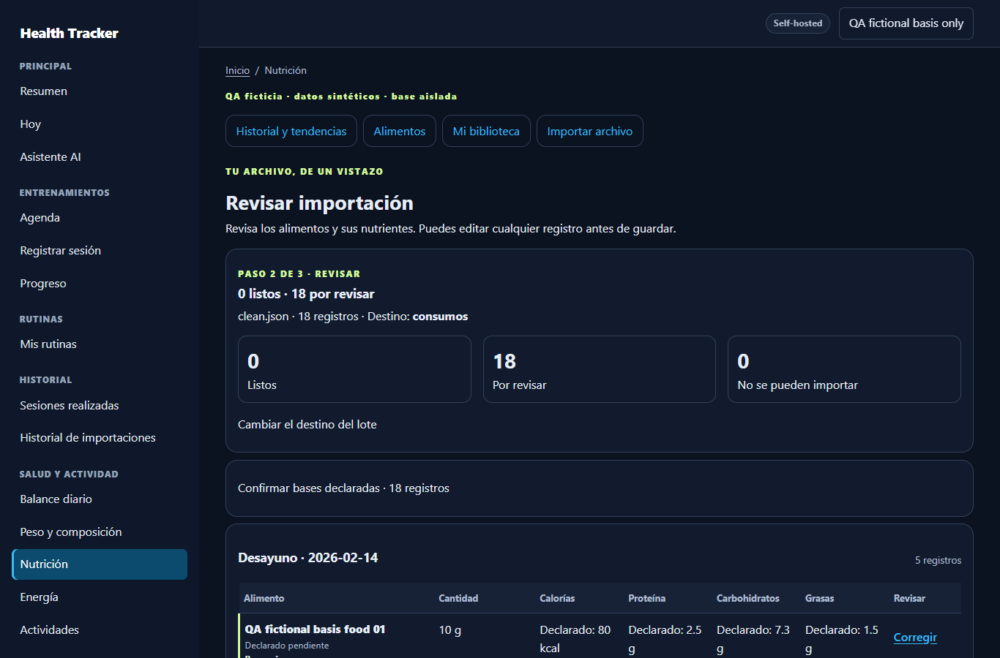
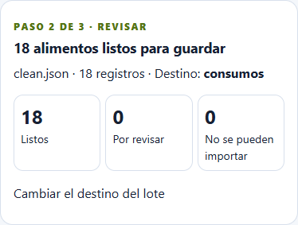

# Issue #38 · declaración fuente y aceptación de bases

## Diagnóstico privado, sólo lectura

El lote afectado es `nutrition_import` **2.1**, válido contra el schema estricto. Sus 18 registros tienen declaración, cantidades y bases compatibles y ninguna contradicción de base, binding, conflicto de fecha o error de archivo. No se publican nombres, fechas, cantidades, nutrientes personales, identificadores ni SHA del archivo.

Las 18 anotaciones editoriales `declaration.provenance.basis_interpretation` contienen únicamente `consumed_quantity`, `basis_unit` y `quality`, como strings. El adaptador las copiaba al campo interno homónimo, que espera decisiones con `kind`, `status` y `origin`. Estos tres controles estaban ausentes: `current()` era falso en las 18 filas. `grouped()` legacy también era falso: exige `consumed_total/proposed/source_basis` y ausencia de resolución; las filas ya conservaban `resolution=declared`.

La preview rechazaba correctamente contar esas filas, pero la presentación traducía la preview ausente a «Sin dato», aun existiendo los valores fuente. El grupo legacy no podía ofrecer una decisión colectiva para este contrato canónico. No es una regresión HTTP 500 ni un problema de notas largas 1.0.

La hipótesis inicial del PR #39 (`unrecognized_daily_nutrition`) no corresponde al original real. Esta entrega actualiza ese mismo PR, conservando su historial y sustituyendo aquella propuesta por el caso 2.1 verificado y sus pruebas. No amplía la aceptación a documentos no reconocidos.

## Corrección acotada

- Mostrar valores **declarados y pendientes**, incluyendo cero, trazas y límites, sin sumarlos como aportes. La disponibilidad de micros distingue declaraciones pendientes de nutrientes ausentes. Comida/lote/fecha indican qué queda sin contabilizar.
- Proyectar una propuesta en lectura sin alterar el draft. Revalidar el original owner-only y su integridad; exigir schema 2.1, destino consumido, entrada original idéntica, la anotación editorial exacta, coincidencia Decimal entre cantidad/base/cantidad anotada y la misma unidad g/ml. No inferir equivalencias ni modificar datos nutricionales.
- Excluir decisiones incompatibles, bindings, bases editadas, etiquetas nominales, contradicciones, ambigüedad neto/total, conflictos del archivo y nutrientes pendientes de resolución. La autoridad del grupo se verifica en servidor; un control inyectado en el archivo no la concede.
- Ofrecer una casilla semántica separada y **un POST oficial de decisiones del borrador**. Usa la validación existente, incremento optimista de revisión, invalidación de firma y una acción auditada. Conserva literalmente las filas excluidas y las revisiones anteriores; rechaza mezclar esta aceptación con otras ediciones o decisiones de fechas.
- Tras aceptar, reutilizar el cálculo Decimal existente por alimento/comida/día, conservando calidad y procedencia. No cambia el schema, modelos, migraciones, TTL, cantidades, bases ni fórmulas.
- Reprocesado: una anotación editorial sin `origin` no se trata como decisión interna completa. El fork conserva el original y la revisión anterior; la recuperación expirada usa el flujo oficial, sin renovar su TTL a mano.

No se altera la semántica legacy `daily_nutrition` 1.0. Los originales, notas y SHA permanecen protegidos.

## Evidencia completamente ficticia

Generador: [`qa_pending_basis_fixtures.py`](../scripts/nutrition/qa_pending_basis_fixtures.py). Crea datos inventados, no derivados de valores personales, con la firma estructural de la anotación afectada.

| Escenario local | Antes | Después de un POST semántico | Consentimiento / dominio |
| --- | --- | --- | --- |
| 18 declaraciones homogéneas, cuatro comidas | 0 listos / 18 pendientes / 0 inválidos; 72 celdas de macros declarados; nada sumado | **18 / 0 / 0**; 30 nutrientes exactos; Guardar todo habilitado | Desmarcado / cero escrituras |
| Una cantidad anotada contradictoria | 0 / 18 / 0 | **17 / 1 / 0**; excepción intacta | Desmarcado / cero escrituras |

## QA focal

- SQLite: **209 PASS** (20 casos nuevos y regresiones source 2.1, semántica/notas 1.0, preview y micros).
- MariaDB 11.4 desechable, head **0046**, **READ COMMITTED y REPEATABLE READ: 69 PASS por perfil**; además, regresiones existentes de 21/23/51, notas 1999/2000/2001/5000, contradicciones, concurrencia, rollback, seguridad y export/restore en ambos perfiles. `db check` sin diferencias.
- Edge/Playwright: **22 escenarios y 264 verificaciones de layout**, desktop/mobile, seis anchuras y temas claro/oscuro. Incluye 18 homogéneos/una excepción, 21/4 con calidad mixta, notas y preview/editor anteriores. Cero errores de navegador.
- Los 30 nutrientes se comparan con sumas independientes Decimal. Pruebas ficticias verifican canonical/snapshot/resumen diario/micros/export-restore, cero conocido, unknown/trace/below_limit, estimados, estados mixtos, invalidación parcial, TTL/reprocess, fecha ya existente, owner/CSRF/revisión/firma y consentimiento final separado.
- GET no hace DML. La aceptación semántica no crea consumos, productos ni recibos. Sólo las pruebas de integración con consentimiento **ficticio** ejercitan la escritura de dominio aislada.
- Compilación Python, sintaxis JS, Compose con variables ficticias y `git diff --check`.

Resultados: [`results.json`](../design/nutrition-pending-basis/qa/results.json), [`browser.json`](../design/nutrition-pending-basis/qa/browser.json), [MariaDB RC](../design/nutrition-pending-basis/qa/mariadb/mariadb-READ_COMMITTED.json), [MariaDB RR](../design/nutrition-pending-basis/qa/mariadb/mariadb-REPEATABLE_READ.json). Son comprobaciones locales, no una afirmación sobre CI o aceptación real.

## Puerta productiva pendiente

**QA PASS · ACEPTACIÓN REAL PENDIENTE.** La producción continúa en `0fc99ce323f80b72f00e101ba620a308c0b59148`: el borrador real permanece **0 listos / 18 pendientes / 0 inválidos**, sin ninguna aceptación o modificación por esta tarea. Las comprobaciones owner-only comparan íntegramente los borradores y registros de dominio con la línea base privada; incluyen el lote de 18, el anterior de 21 y el de 23 completados. Originales e integridad verificados. También se preservan 151 archivos locales anteriores.

Este PR no despliega, fusiona ni cierra #38. Después de revisión e integración por PM, el despliegue controlado debe comprobar la pantalla real del propietario y obtener su aceptación semántica: **18 listos / 0 pendientes / 0 inválidos**, macros/micros y totales correctos, Guardar todo habilitado y consentimiento desmarcado. No pulsar Guardar todo ni crear consumos/productos/recibos. Sólo esa comprobación permite declarar aceptación real satisfactoria.
