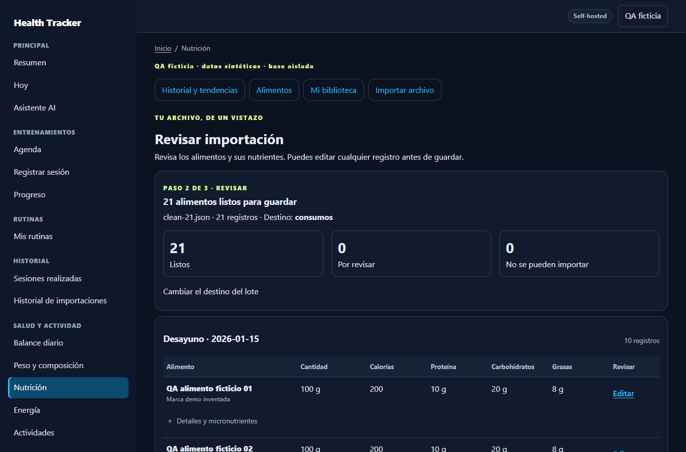
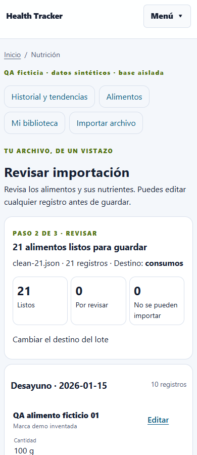
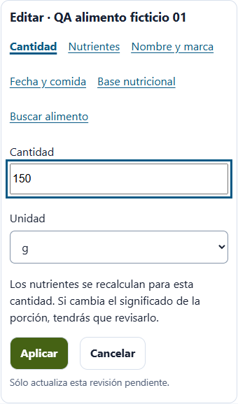
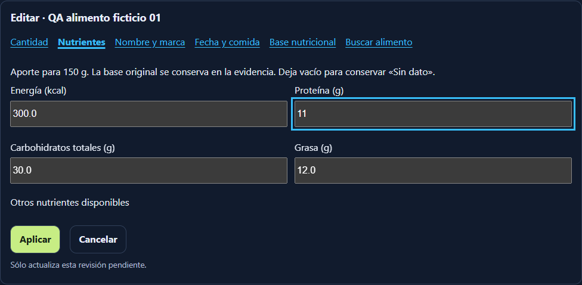

# Issue #32 — vista previa editable de importación nutricional

Base comprobada local/remota: `c9cbb86b7b558d6b8c1e838e64966e2a48700bd9`.
Rama: `codex/issue-32-nutrition-preview`. No fusionar ni desplegar automáticamente.

## Comportamiento

Subir → revisar todos los alimentos → editar si se desea → **Guardar todo**.
La revisión muestra nombre/marca, cantidad, calorías y macros, fecha/comida y
calidad en lectura. Agrupa por fecha y momento; usa tabla en escritorio y tarjetas
en móvil/ancho intermedio. Detalles, micronutrientes, originales y procedencia
permanecen cerrados. «Sin dato» conserva ausencia; cero conocido sigue siendo cero.

Cada registro tiene **Editar**, aunque sea válido. Abre sólo su editor contextual:
cantidad, nutrientes, identidad, fecha/comida o base. **Aplicar** hace un POST de
borrador para esa fila; **Cancelar** es un GET sin escrituras. Los errores reales
se señalan en la fila habitual mediante **Corregir** y explicación. El error de
entrada se anuncia con `role=alert`, conserva lo escrito y mantiene el editor.

El resumen de comida y lote usa los mismos cálculos Decimal que los snapshots.
Los subtotales parciales se identifican; un registro sin base verificable no
aporta una cifra plausible al total. Se muestran estimaciones, valores desconocidos
y diferencias de aporte tras editar. Los productos muestran valores de referencia,
sin presentarlos como ingesta. El único guardado de dominio está al final, después
del resumen; el consentimiento de consumos reales permanece desmarcado.

## Reutilización y contrato

- `nutrition_import_preview.py` presenta las filas de todos los adaptadores
  existentes; no añade parsers ni promete extracción universal de PDF/fotografías.
- Una declaración suficiente con base/unidad verificables puede registrar consumo
  sin catálogo ni producto. La selección explícita de catálogo/creación privada
  sigue disponible y prevalece sobre la derivación automática. Cambiar de destino
  productos a consumos no conserva una propuesta automática de producto.
- La aceptación semántica legacy respaldada por el contrato sigue agrupada y
  desmarcada. Las incertidumbres auténticas se corrigen individualmente. Una
  advertencia/estimación etiquetada no es por sí sola un bloqueo.
- El extractor interno pasa de v3 a `nutrition-editable-preview-v4`. GET no
  reescribe revisiones anteriores. Reprocesado #29/#30/#31 crea/reutiliza fork
  trazable desde bytes/SHA verificados; conserva originales y decisiones compatibles,
  con aceptación separada de campos heredados. No traslada firmas ni consentimientos.
- No cambia ningún JSON Schema, tabla, dependencia, migración ni protocolo móvil.
  Alembic sigue en `20261018_0046`. Nutrition Intelligence C queda fuera de alcance.

### Ediciones y escalado

La cantidad escala la contribución una vez; conserva concentraciones y proporciones
de ingredientes. Un cambio de unidad no convierte implícitamente una composición.
Las equivalencias y etiquetas afectadas pierden su verificación. Para una edición
contextual de cantidad con base fija ya verificada (por 100, base explícita o total
original aceptado), se conserva esa interpretación si todo lo demás sigue idéntico.
Un total de la cantidad consumida o cambio de base/etiqueta/equivalencia requiere
volver a interpretar lo afectado; las demás filas se conservan byte a byte.

El editor de nutrientes recibe el aporte de la cantidad visible. Si cambia una
cifra, expresa la declaración revisada sobre esa cantidad y convierte las otras
cifras una sola vez; evita dividir el dato editado en una concentración periódica
y volver a multiplicarlo con deriva. Originales y valores anteriores quedan en
`original_values`/evidencia y en la procedencia `corrections`. La marca efectiva
viaja en la procedencia de declaración; reupload 2.1 conserva la corrección.

Las bases contradictorias externas, incluida mezcla por 100 g/ml o mezcla de bases
sin autoridad explícita, bloquean hasta verificación contextual. Ninguna unidad,
equivalencia, identidad ni fecha ausente se inventa para dejar el lote listo.

### Seguridad y persistencia

Owner efectivo de sesión; POST y CSRF; lock de propietario; revisión optimista y
TTL de borrador 24 h; firma global 15 min ligada a owner/revisión/documento/plan;
revalidación antes y después de persistir auditoría pending. Se conserva
`StandardImportExecutor`, un recibo, deduplicación, idempotencia y rollback completo.
Sin guardado parcial. GET, búsquedas, apertura/cancelación de editor y decisiones
no guardan MealLog, FoodProduct, Recipe ni recibos.

El gate de 51 alimentos detectó que la proyección anterior creaba 51 comidas,
superando `daily_nutrition` 1.0 (máximo 50 comidas). El importador ahora agrupa
proyecciones nuevas del mismo lote por fecha/tipo de comida mediante el servicio
oficial `nutrition_intelligence.confirm`, con comprobación owner/día/tipo y máximo
200 elementos por grupo. Mantiene 51 MealLogs/snapshots individuales. No reagrupa
historial previo ni cambia el contrato público. Export/restore de los 51 está probado.

## QA reproducible y evidencia ficticia

Fixtures [JSON limpio de 21](../examples/qa/nutrition-import-preview/clean-21.json),
[51 con un error](../examples/qa/nutrition-import-preview/one-error-51.json) y CSV
generado por [qa_preview_fixtures.py](../scripts/nutrition/qa_preview_fixtures.py).
Todos los nombres, cuentas, marcas y nutrientes son inventados para QA.

| Recorrido real Flask/Edge | Botones/enlaces | POST totales | Campos/consentimientos | Correcciones | Guardados | Productos | Recibos |
| --- | ---: | ---: | ---: | ---: | ---: | ---: | ---: |
| 21 válidos, móvil y escritorio | 2 | 2 | 1 consentimiento | 0 | 21 | 0 | 1 |
| 50 válidos + 1 base contradictoria | 4 | 3 | 1 verificación + 1 consentimiento | 1 | 51 | 0 | 1 |
| Cantidad + macro + otra edición cancelada | 9 | 4 | 2 cambios + 1 cancelado + consentimiento | 0 errores; 2 ediciones voluntarias | 21 | 0 | 1 |

POST incluye subir y guardar; no incluye login, GET, scroll ni selección nativa
del archivo. Campos no significa clics físicos. La cancelación no hace POST.
En todos los casos hay cero formularios individuales abiertos al cargar y cero
escrituras de dominio antes del guardado final. [Medición completa](../design/nutrition-import-preview/qa/browser.json).

Sobre la misma fixture limpia, los módulos exactos de #31 producen 0 listos/21
pendientes y necesitan `use_declarations`: mínimo 3 POST contando subir/guardar,
frente a 2 ahora. Además, la tabla antes estaba cerrada y los 21 formularios de
excepción protagonizaban la revisión. La comparación se comprueba ejecutando los
blobs de Git; no se atribuye esa medición al segundo archivo personal.

- **247 pruebas SQLite focales PASS** cubren legacy, aliases externos, 2.1, CSV, TSV, XLSX y texto;
  unidades/calidad, ediciones exactas, cancelación, originales, owner/CSRF,
  revisiones, vencimiento, reprocesado exacto #29/#30/#31, conflictos, firma,
  consentimiento, replay, rollback y export/restore. Las pruebas previas conservan
  PDF/OCR e imágenes dentro de los límites ya soportados.
- MariaDB **0046 RC y RR PASS**, `db check` sin operaciones nuevas; tres escenarios
  por aislamiento y seis reprocesados #29/#30/#31 vigentes/vencidos, rollback tras escritura, concurrencia de edición (302/409),
  guardado concurrente (200/409), un recibo y export/restore oficial.
  [RC](../design/nutrition-import-preview/qa/mariadb-READ_COMMITTED.json),
  [RR](../design/nutrition-import-preview/qa/mariadb-REPEATABLE_READ.json).
- Flask/Edge real: móvil 390 claro y escritorio 1366 oscuro; matriz 360, 390,
  430, 768, 1024 y 1366 en ambos temas, sin overflow ni inputs pequeños. Guardado
  final por teclado; cancelar conserva revisión. Inspección visual adicional en
  navegador integrado sobre cuenta ficticia, sin confirmar dominio en esa cuenta.
  No se declara certificación WCAG ni prueba de lector de pantalla humano.
- Suite general: **1567 PASS, 35 skipped, 1 fallo ajeno**: el handoff operativo
  local preexistente tiene 160 líneas y su test exige ≤80. Se preservó ese documento.
  El mismo test con los documentos del HEAD versionado pasa sin modificar el
  working tree. [Evidencia y distinción](../design/nutrition-import-preview/qa/general-suite.json).

Capturas:

Estados de 51: [con error](../design/nutrition-import-preview/qa/error-preview-desktop.png),
[editor](../design/nutrition-import-preview/qa/error-editor-desktop.png),
[corregido](../design/nutrition-import-preview/qa/error-corrected-desktop.png).

Reproducir desde raíz con Python del proyecto:

1. Ejecutar `scripts/nutrition/qa_preview_fixtures.py`.
2. Ejecutar las suites `test_nutrition_import_*`, `test_nutrition_experience_21`,
   `test_nutrition_intelligence`, `test_nutrition_micros` y relacionadas.
3. Ejecutar `scripts/nutrition/qa_preview_ui.py` (SQLite/storage temporales, loopback
   8042) y `node scripts/nutrition/ui_qa_preview.cjs` con Playwright disponible.
4. Crear **otro** MariaDB 11.4 desechable, nombre `health-tracker-issue32-qa-db`,
   tmpfs de DB, puerto **127.0.0.1:33432**, schema `nutrition_preview_qa` y credenciales
   ficticias documentadas en el arnés. Ejecutar `mariadb_preview_qa.py` con
   `QA_ISOLATION=READ COMMITTED` y `REPEATABLE READ`. El arnés aplica las migraciones
   reales sólo a ese schema/puerto locales; nunca usarlo contra datos persistentes.

## Despliegue posterior a revisión

No se accedió al NAS, `.env`, `/data`, volúmenes persistentes ni importación real.
Los documentos/evidencias operativos locales preexistentes quedan fuera del PR.

Después de aprobación explícita: comprobar base/HEAD/protecciones; conservar
imagen compatible; obtener backup nuevo consistente DB/storage con checksum y
restore aislado completo mediante el procedimiento existente; construir desde
el squash revisado; validar 0046 y `db check`; recrear sólo web con el Compose
principal. No recrear MariaDB ni volúmenes ni cambiar secretos/flags/puertos.

Comprobar imagen activa, smoke autenticado de importación/biblioteca/nutrición/
micronutrientes/dashboard/energía, no-store y GET sin escrituras. Verificar tanto
subida nueva como fork de revisión anterior conservando originales/decisiones.
Ante fallo crítico, recuperar sólo imagen compatible; no restaurar un backup
antiguo sobre escrituras nuevas. La aceptación privada del segundo archivo real
queda para el propietario; no se copió ni se confirmó ningún consumo personal.
