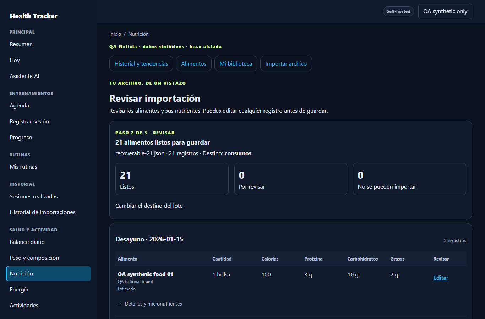
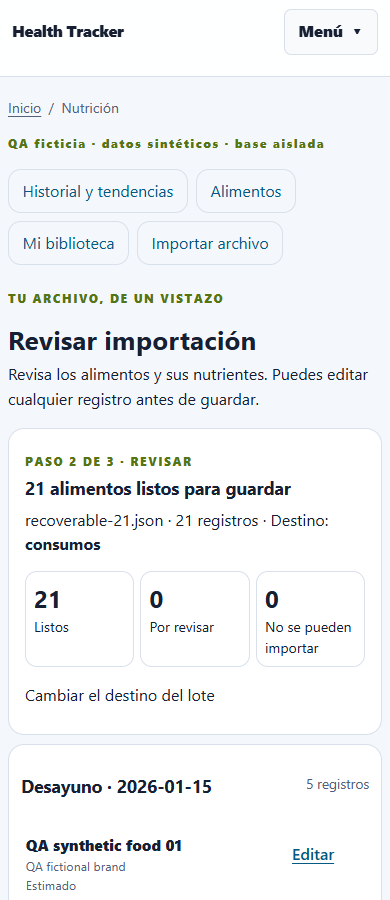
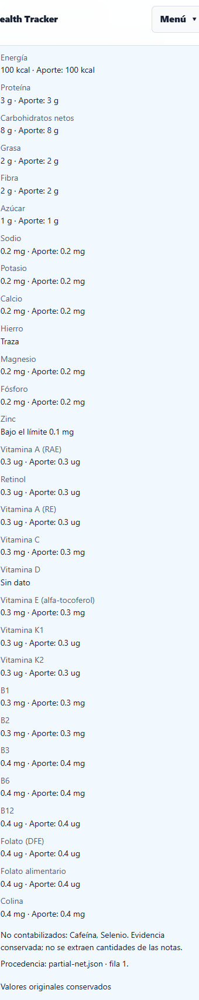

# Issue #36 · revisión unificada de Nutrition Import 1.0 / 2.1

La subida de un origen 2.1 con cuatro comidas y 21 alimentos produce una vista de **21 filas / cuatro grupos**, sin productos privados obligatorios. El caso inequívoco requiere dos POST: subir y guardar tras consentimiento. La validación pública 2.1 permanece estricta.

## Causa reproducida

Base: `01b49cafc36ec95e11d0aed3aca11dcfdf49a5c0`. [Reproducción sintética](../scripts/nutrition/reproduce_source_21_500.py) y [resultado](../design/nutrition-source-21/qa/baseline-500.json).

1. `SchemaDetector.detect` devolvía `assistant_required` cuando faltaban `data.source_sha256`, `data.event_key` o las unidades no eran canónicas.
2. `nutrition_sources.json_rows` ignoraba ese resultado y retornaba incondicionalmente el documento como estándar.
3. `nutrition_import.start` almacenaba y comprometía el original antes de construir la revisión.
4. `_review_from_source` lanzaba `JsonSchemaValidationError` al llamar a `validate_json_document`. La ruta sólo trataba los errores de nutrición; Flask respondía **500**.

La reproducción contra los blobs públicos de la base certifica HTTP 500, clase exacta y un `UploadedFile` persistido tras el fallo. Sólo utiliza datos ficticios; no afirma disponer del stack del incidente personal.

## Contrato de adaptación

- Un documento estrictamente válido conserva su contrato canónico. Las composiciones de consumos sin declaración autoritativa del padre se descomponen por binding; un padre con declaración propia se conserva como una sola contribución. No se suman simultáneamente padre e hijos.
- Un origen 2.1 reconocible y recuperable usa el adaptador de lectura [nutrition_source_21.py](../backend/app/services/importers/nutrition_source_21.py). La falta de identificadores finales no obliga a inventarlos: el servicio oficial genera después el documento canónico con el SHA real y el evento del propietario efectivo.
- Cada `new_food.nutrition.nutrients` pasa a la declaración de su alimento consumido. Se conservan marca, fecha/comida, cantidad, base, calidad, original y procedencia. `new_food` no obliga a crear un producto. Los vínculos `ref` + revisión se resuelven en el catálogo/biblioteca del propietario; nunca se vincula por nombre.
- Las unidades nominales inequívocas se normalizan a `portion`, manteniendo su significado y los textos originales en evidencia. Una base compatible se escala una sola vez con Decimal. Unidades incompatibles o referencias no verificables quedan bloqueadas; no se inventa masa, volumen o densidad.
- El original completo se conserva. La evidencia grande de la comida se retiene una vez en el primer alimento, con SHA e índices para los demás, evitando multiplicar sus notas por el número de bindings.
- Tipos/versiones desconocidos y estructuras irrecuperables devuelven 422 seguro antes de almacenar. No se muestran mensajes de validación con el payload. El alta HTTP de archivo y borrador comparte transacción; un fallo posterior revierte ambos y elimina exclusivamente el archivo nuevo no compartido. Un upload duplicado previo queda intacto.
- `confirmed:true` del archivo no es consentimiento. Tampoco puede preaceptar añadir consumos a una fecha existente o decidir la autoridad de un agregado previo. Se conservan revisión optimista, CSRF, firma y consentimiento explícito de consumo.

Extractor: `nutrition-source-21-v6`. El reprocesado conserva una interpretación ya aceptada sólo si el nuevo extractor reproduce exactamente significado e inputs efectivos. Las contradicciones y equivalencias no verificadas siguen requiriendo revisión. Se prueba contra código v5 real, vigente y vencido, sin modificar la revisión anterior ni renovar su TTL.

## Macros, micros y evidencia no contabilizada

Los 30 nutrientes actuales se verifican en declaración, preview por alimento, sumas por comida/día, snapshot, Nutrition, micros 7/30/90, Unified Summary y export/restore. Carbohidratos totales y netos permanecen como claves distintas; no se suman entre sí para fabricar un aporte. Ausentes y `unknown` no se convierten en cero. `trace` y `below_limit` conservan sus estados y se muestran también cuando proceden de una declaración sin ingredientes. Las estimaciones mantienen su clasificación.

No se amplía el vocabulario en este PR. Los nutrientes estructurados soportados ya cubren la muestra de referencia. Biotina, manganeso, cobre, selenio y B5 fuera del diccionario, y sustancias como cafeína, se conservan en evidencia y se identifican como **no contabilizados**. La detección sólo reconoce términos para advertir; nunca extrae cantidades de prosa ni los introduce en el vector canónico.

## Fixtures y QA

Todas las cifras, nombres, marcas, notas y fechas publicadas son ficticias, generadas independientemente del archivo personal. La muestra proporcionada por el usuario está identificada como sintética y sólo se inspeccionó localmente; no se copió a Git.

| Caso | Fixture / comportamiento |
|---|---|
| A/C | [21 alimentos recuperables](../examples/qa/nutrition-source-21/recoverable-21.json): cuatro comidas, tres unidades nominales y ausencia de IDs finales |
| B | [2.1 canónico](../examples/qa/nutrition-source-21/canonical-21.json), con [fuente sintética del SHA](../examples/qa/nutrition-source-21/canonical-source-evidence.json) |
| D | [Estructura irrecuperable](../examples/qa/nutrition-source-21/malformed.json): 422, sin original ni borrador |
| E | [Una base contradictoria](../examples/qa/nutrition-source-21/one-conflict.json): 20 listos y una excepción; corregir sólo esa fila |
| F | [Parciales, netos y estados cualificados](../examples/qa/nutrition-source-21/partial-net.json): desconocidos, traza y límites preservados |

Resultados observados y comandos:

- **19 pruebas nuevas SQLite PASS**, incluyendo vector completo, recorrido hasta Unified Summary, export/restore, recuperación v5, identidades exactas, composición canónica, seguridad, rollback, replay y uploads sin huérfanos.
- **186 regresiones SQLite PASS**: 1.0, notas extensas/contradictorias, revisiones previas, 21 limpios, 51 con una excepción, consentimientos, micros y edición contextual.
- **MariaDB 0046 RC/RR: 19 casos nuevos por perfil PASS**, migraciones reales y `db check` sin DDL pendiente. [Regresiones RC](../design/nutrition-source-21/qa/mariadb-READ_COMMITTED.json) y [RR](../design/nutrition-source-21/qa/mariadb-REPEATABLE_READ.json): concurrencia, owner/CSRF/firma, rollback/replay, forks #29–35 y round-trip PASS.
- **Flask/Edge: seis escenarios y 72 combinaciones de anchura/tema PASS**, móvil/escritorio, sin errores JS. Preview y resumen persistido coinciden en todos los nutrientes. [Evidencia](../design/nutrition-source-21/qa/browser.json).
- **Regresiones visuales adicionales: diez escenarios / 72 comprobaciones PASS**, sin alterar las capturas históricas: [preview 21/51 y edición](../design/nutrition-source-21/qa/regression-preview/browser.json), [notas extensas/contradictorias](../design/nutrition-source-21/qa/regression-notes/browser.json). Total de esta campaña: **16 escenarios / 144 comprobaciones**.
- Compilación, head único `20261018_0046`, Compose con valores ficticios y env-file vacío, y `git diff --check`: PASS. Sin cambios de modelos, schemas, migraciones o dependencias.
- Última suite general local: **1.644 PASS / 35 skip / 1 fallo preexistente** en `test_active_handoff`: el working tree anterior conserva 160 líneas frente al límite de 80. Ese documento ajeno no se incluye en el PR; la versión de la base tiene 35 líneas. Esa corrida precede a las dos últimas regresiones de borde; los 19 casos focales se verificaron después sobre el código final. No se declara la suite general completamente verde. [Resumen de QA](../design/nutrition-source-21/qa/results.json).

```powershell
$env:FLASK_SKIP_DOTENV='1'
.venv/Scripts/python.exe scripts/nutrition/build_source_21_fixtures.py
.venv/Scripts/python.exe scripts/nutrition/reproduce_source_21_500.py
.venv/Scripts/python.exe -m pytest -q backend/tests/test_nutrition_import_source_21.py
```

Para MariaDB, crear exclusivamente una instancia QA con tmpfs y publicación loopback `127.0.0.1:33436`, schema `nutrition_preview_qa`. El fixture rechaza cualquier otro destino. Definir `QA_SOURCE21_DATABASE_URL` con credenciales ficticias de esa instancia y ejecutar el mismo módulo con `QA_ISOLATION='READ COMMITTED'` y después `'REPEATABLE READ'`. Nunca apuntarlo a una base personal.

Para navegador, ejecutar `qa_source_21_ui.py` (SQLite y storage temporales, loopback 8042), después `ui_qa_source_21.cjs`; sus cuentas, archivos y guardados son ficticios. Los scripts previos de preview y notas mantienen las regresiones del flujo 1.0.

## Interacciones y capturas

Antes: una subida terminaba en 500 y no había preview utilizable; no se inventa una métrica de 21 confirmaciones del flujo fallido. Después: caso claro **2 POST**, cero decisiones individuales y cero productos; excepción auténtica **3 POST**, con una sola corrección. El único botón principal final sigue siendo `Guardar todo`, con consentimiento desmarcado.





## Plan seguro posterior a revisión

Este PR no hace merge ni despliegue. Producción y sus revisiones anteriores, incluido el lote preparado en v5, permanecen intactos.

1. Revisar el PR y sus gates; obtener autorización posterior para integrar y desplegar el squash concreto.
2. Conservar cambios/documentos locales, configuración y secretos; sincronizar sin reset/clean y comprobar SHA e imagen anterior.
3. Backup fresco consistente de DB y storage, checksums y restore aislado a destino vacío. Detener si falla la comparación de tablas/índices/filas/archivos.
4. Construir la imagen exacta y repetir QA focal sobre ella en MariaDB 0046 RC/RR aislada. Actualizar sólo `web` del Compose principal; conservar MariaDB y volúmenes. Smoke HTTP/HTTPS autenticado, healthz, logs y db check. Rollback sólo de imagen compatible sobre datos actuales.
5. Aceptación personal 2.1 posterior, en sesión propietaria: reupload/reprocesado oficial trazable, medir alimentos, micros, totales y excepciones reales. No copiar el original a QA/Git ni confirmar consumos sin autorización expresa. La aceptación sintética no sustituye ese gate privado.
