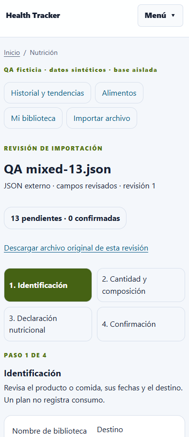
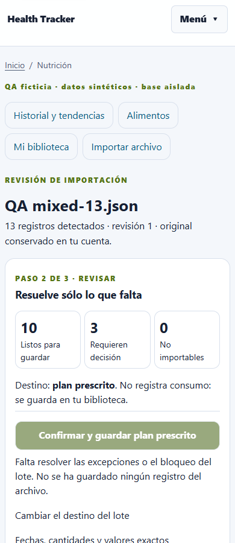

# Importación nutricional: subir, revisar excepciones, guardar

Entrega del PR #29, con cierre focal autorizado, desde master
`430164e4f868e0ad5743b49223f87a330107c0b0`, rama
`codex/nutrition-import-three-screens`. **Sin merge ni despliegue.**
Prioridad UX sobre la ampliación de enriquecimiento personal. No se accedió al
NAS ni a la importación pendiente real del usuario.

## Fricción reproducida y resultado

La fixture ficticia contiene 13 comidas, 26 ingredientes, diez registros
inequívocos y tres excepciones: cantidad ausente, identidad aproximada sin
referencia verificable y carbohidratos sin distinción total/neto.

El flujo anterior tenía cuatro etapas después de subir: guardar identificación,
guardar composición, vincular ingredientes, guardar declaración y confirmar cada
fila antes de confirmar el archivo. `ingredient_proposals` se extraía, pero no
resolvía vínculos explícitos. Guardar un formulario reenviaba a la etapa sin
conservar la búsqueda: cada ingrediente necesitaba volver a buscar candidatos.

| Medición sobre el mismo archivo QA | Anterior | Nuevo |
| --- | ---: | ---: |
| POST de importación/revisión/confirmación | 81 | 3 |
| Búsquedas locales necesarias en la UI | 26 | 1 |
| Enlaces entre etapas de revisión | 3 | 0 |
| Activaciones de botones/enlaces | **110** | **4** |
| Confirmaciones individuales de fila | 13 | 0 |
| Casillas de composición completa para conservar el dato explícito | 13 | 0 |
| Confirmación separada de destino ya detectado | 1 | 0 |
| Confirmación global de guardado | 1 | 1 |
| Registros guardados | 13 | 13 |

Reducción del **96,4 %** en activaciones de envío/navegación y **96,3 %** en POST.
Se cuentan botones y enlaces, no clics físicos de toda la sesión: quedan fuera
escritura, cambios de select, casillas y selector nativo de archivo. No se cuentan
login, navegación instrumental de QA o recarga automática de un redirect.

El recorrido HTTP inicial había medido un mínimo de 84 acciones, asumiendo que
los candidatos estaban disponibles; la reproducción real Flask/Edge añadió las
26 búsquedas obligadas por la pérdida de `q`, alcanzando 110. Ambas evidencias se
conservan para que el denominador sea auditable. No se suman campañas distintas.

Un segundo archivo ficticio de diez registros inequívocos requiere **dos POST y
dos activaciones principales: subir y confirmar**. El destino es un plan explícito;
para consumos reales se mantiene además el consentimiento global de consumo.

## Experiencia implementada

1. **Subir archivo.** Original privado y SHA-256 por el servicio existente.
   La misma fuente pendiente reabre la revisión y sus decisiones en vez de
   multiplicar borradores. Se listan revisiones pendientes owner-only.
2. **Resumen único.** Cantidades de listos, requieren decisión y no importables;
   destino visible, botón principal dentro del primer viewport comprobado y
   detalles opcionales. Sólo las excepciones muestran controles. Una búsqueda
   local alimenta sus selectores; ninguna opción aproximada se preselecciona.
   Todas las decisiones se aplican juntas a la revisión, sin importar dominio.
   También se puede resolver una excepción, salir y retomar las restantes.
3. **Resultado.** Registros guardados y pendientes, recibo existente ante replay,
   conteos de planes/productos/consumos y navegación a biblioteca o historial.
   Un fallo transaccional conserva la revisión y ofrece retomarla.

No hay una página adicional obligatoria para cada ingrediente, nutriente o fila.
Los antiguos parámetros `step` abren el mismo resumen; los endpoints de edición
antiguos siguen validando y conservando el resto de campos. No se reescriben
revisiones antiguas al consultarlas.

La prevalidación conserva bases explícitas, fechas, cantidades, unidades y
nutrientes exactos, incluyendo cero/unknown/trace/below_limit cuando vienen en
un vector válido. Reutiliza NUTRIENTS, Decimal y validadores oficiales. El
agregado diario estándar conserva su significado de un día, sin crear un alimento.

La vinculación automática requiere referencia explícita o source + source_food_id,
preparación y revisión coincidentes, y después pasa cantidad, unidad y densidad
por el cálculo oficial. La búsqueda textual sólo ofrece candidatos. Unidades
incompatibles, cantidades ambiguas, porcentajes de referencia y carbohidratos
sin clasificar bloquean el elemento hasta una decisión contextual. Elegir
“desconocido” conserva la evidencia original; no crea un cero ni una estimación
considerada conocida. Un vector no soportado se explica como no importable.

Las definiciones personales nuevas sólo se proponen cuando el destino es
productos y la definición del archivo es explícita y válida, o mediante una
decisión expresa. Se escriben por el adaptador existente durante la confirmación
global; no se completan ni sustituyen alimentos personales anteriores.

## Autoridad, transacción e idempotencia

Se conservan `NutritionImportDraft`, `NutritionImportReceipt` y
`StandardImportExecutor`; no se introduce otro escritor de nutrición.

- GET trabaja sobre copias y consultas; no persiste normalización ni aceptación.
- La revisión de excepciones tiene POST, CSRF, owner efectivo, revisión optimista
  y límites existentes. No acepta un destino de usuario procedente del archivo.
- La confirmación global contiene una firma de owner, identidad del borrador,
  revisión y hash del documento, además de la firma existente del payload/plan
  de StandardImportExecutor. Caduca en 15 minutos; la revisión conserva el límite
  existente de 24 horas. Cambios o caducidad requieren revisar de nuevo.
- Consumos requieren consentimiento global explícito. Conflictos de fechas y
  autoridad legacy siguen necesitando decisiones; no se sobrescriben días.
- Tras el commit independiente de la auditoría pending, el ejecutor vuelve a
  adquirir lock del owner y de la revisión, comprueba revisión y documento y sólo
  entonces escribe. El cierre del borrador se confirma en la **misma transacción**
  que el dominio, el recibo y la auditoría succeeded.
- Mismo evento/documento conserva la idempotencia oficial. Un replay de la
  confirmación firmada devuelve el recibo sin duplicar. Una subida repetida
  muestra el resultado del archivo ya confirmado. Un evento con documento
  diferente sigue siendo conflicto en el servicio oficial, sin sobreescritura.
- Dos confirmaciones concurrentes produjeron 200/409 en ambos aislamientos
  MariaDB, con exactamente un plan y un recibo para el evento. El 409 exige
  refrescar; no se afirma que ambos clientes reciban necesariamente 200.
- Fallo inducido después de escribir/flush del dominio: rollback completo,
  cero plan/recibo parcial y revisión pendiente conservada.

El original se conserva mediante el store oficial, aislado por propietario.
SHA-256 y bytes del archivo QA se comprobaron tras guardar decisiones y reabrir.
Los controles existentes de eliminación/retención y sus protecciones siguen
vigentes, también para revisiones compartidas antiguas.

## Guardado parcial de dominio: deliberadamente deshabilitado

Hoy `canonical` produce un evento derivado del SHA del archivo; el recibo guarda
el documento completo. Importar diez filas y volver con otras tres para ese
evento cambia el documento y genera conflicto. Cambiar arbitrariamente el evento
no basta: los IDs de consumo actuales dependen del índice de las entradas, que
puede cambiar al filtrarlas; planes, agregados, autoridad del día y recibos de
export/restore también necesitan semántica definida.

Por eso no hay botón “guardar listos y completar después”. Las excepciones
bloquean el guardado **de todo el lote** y permanecen en su revisión. Guardar
decisiones parciales del formulario no se presenta como importar parcialmente.
Las omisiones que ya existan en un borrador legacy conservan su significado de
omisión, no se convierten en pendientes recuperables después del recibo.

Cambio mínimo para revisar por separado antes de habilitar parcial:

1. Identidad estable por elemento original: owner servidor, SHA del original,
   coordenada/índice original y ocurrencia; no sólo hash del alimento, porque dos
   registros iguales pueden representar consumos distintos.
2. Manifiesto explícito de lote/subconjunto con hash de selecciones y decisiones;
   recibos que impidan importar dos veces el mismo elemento, aunque cambie el
   orden o se complete en otro intento.
3. Estado persistente de pendientes/guardados y referencias a recibos. Transacción
   atómica por subconjunto y actualización del progreso en esa misma transacción;
   recuperación tras fallo sin marcar como completado el archivo entero.
4. Semántica revisada para un plan que se completa en varios intentos y para
   conflictos del día; conservar snapshots anteriores y consentimiento de consumo.
5. Contrato de export/restore y retención del original/progreso. Restaurar o
   reintentar no puede perder pendientes ni reiniciar IDs de eventos confirmados.

La insuficiencia demostrada es del **contrato de evento/progreso actual**. No se
concluye que hagan falta tablas nuevas: primero debe revisarse si JSON de revisión
y las claves únicas actuales permiten representarlo con garantías. Este PR no
cambia schemas, recibos públicos, tablas ni migraciones para simular parcial.

## Validación y reproducción

- SQLite sintética: 161 pruebas dirigidas de Nutrition 2.1, A/B, importador,
  recibos, fuentes, historial, Unified Summary y Energy PASS; después, la suite
  nueva de 11 pruebas volvió a pasar al añadir reanudación de decisiones parciales.
  Hay solapamiento: no sumar 161 + 11. No se ejecutó la suite global.
- MariaDB QA local aislada a `20261018_0046`: READ COMMITTED y REPEATABLE READ,
  `db check`, GET sin DML/DDL, owner, CSRF/firma/caducidad, revisión, rollback,
  replay/reupload y concurrencia PASS. Runtime B conservado, app candidata
  montada read-only. Nunca se usaron cuentas o datos productivos.
- Flask/Edge real: 360, 390, 430, 768, 1024 y 1366 px, claro/oscuro; 12
  combinaciones, botón principal visible, sin overflow global, foco visible,
  tablas con caption, detalles cerrados inicialmente, cero errores JS y cero
  solicitudes externas. Se inspeccionaron capturas móvil/escritorio. Sin campaña
  general de accesibilidad ni afirmación de certificación completa.
- `compileall`, `git diff --check`, Compose config con valores ficticios y
  `flask db check` CLI en MariaDB QA PASS. Sin cambios a Alembic 0046, schemas,
  dependencias, contratos móviles ni servicios Energy/Unified Summary.

Fixtures: [13 registros](../examples/qa/nutrition-import-ux/mixed-13.json),
[10 inequívocos](../examples/qa/nutrition-import-ux/normal-10.json),
[catálogo sintético](../examples/qa/nutrition-import-ux/catalog.json).
Evidencia: [baseline HTTP mínimo](../design/nutrition-import-ux/qa/baseline.json),
[baseline de navegador](../design/nutrition-import-ux/qa/baseline-browser.json),
[UI nueva](../design/nutrition-import-ux/qa/ui-report.json),
[MariaDB](../design/nutrition-import-ux/qa/mariadb.json),
[verificaciones](../design/nutrition-import-ux/qa/checks.json).

Reproducción local con la venv existente, desde la raíz:

```powershell
python scripts/nutrition/qa_import_ui.py
node scripts/nutrition/ui_qa_import.cjs
```

El script UI comparativo espera además el servidor baseline en loopback 8036:
`qa_import_ui.py --baseline --port 8036 --app-root <copia del código base>`.
La copia se obtiene con `git archive` del SHA base, únicamente backend/app,
backend/migrations y schemas. `ui_qa_import_baseline.cjs` recorre las cuatro etapas
anteriores. `qa_import_baseline.py --app-root <copia del código base>` reproduce
las mutaciones HTTP mínimas. Los servidores crean SQLite/storage temporales y
usuarios ficticios; no leen `.env`, no se conectan al NAS ni cargan datos reales.
Playwright es dependencia de la herramienta QA, no del producto.

El script `mariadb_import_ux_qa.py` exige el schema QA aislado existente y 0046;
consume configuración QA convencionalmente, sin imprimirla. No crea, actualiza
o sella el esquema. Sus diagnósticos completos quedan privados fuera de Git;
sólo resultados agregados se incluyen en la evidencia.

## Capturas de Flask

| Anterior, móvil | Nuevo, móvil |
| --- | --- |
|  |  |

[Excepciones compactas](../design/nutrition-import-ux/qa/exceptions-light-390.png),
[listo para confirmar](../design/nutrition-import-ux/qa/ready-390.png),
[resultado](../design/nutrition-import-ux/qa/result-390.png),
[escritorio oscuro](../design/nutrition-import-ux/qa/summary-dark-1366.png).


## Cierre de hallazgos del PR #29 — 27-10-2026

La revisión publicada sobre `ec7d3b7` contiene una precisión corregida:
`NutritionError` **hereda de ValueError** (`nutrition_math.py`). El GET ya capturaba
la caducidad; no se reprodujo ni se afirma un HTTP 500 por ese motivo. El problema
real era ofrecer como reanudable una revisión que había superado 24 horas.

Ahora el listado separa vigentes de vencidas/sin original. El acceso directo a
una vencida devuelve 200 con explicación y acción de recuperación, sin el formulario
firmado de guardado. La recuperación es POST + CSRF + owner + revisión; verifica
bytes/SHA/tamaño mediante el resolvedor oficial y vuelve a extraer el original
retenido. Crea una revisión nueva o reutiliza la vigente para esa fuente bajo
lock del owner. No copia decisiones vencidas ni cambia created_at/TTL de la
anterior. Ambas revisiones mantienen el vínculo al mismo original y trazabilidad
recovered_from/recovered_to. Repetir recuperación o reupload devuelve la revisión
vigente, sin duplicar importaciones. Si no hay original íntegro, bloquea y ofrece
subirlo de nuevo o preparar desde biblioteca. Las firmas siguen en 15 minutos;
ninguna firma antigua se reactiva.

### Archivo cotidiano sin referencias del catálogo

Nueva [fixture CSV ficticia](../examples/qa/nutrition-import-ux/representative-plan.csv):
pollo cocido sin aceite, arroz blanco cocido y ensalada de lechuga/pepino sin
aderezo; seis registros de dos momentos de comida, gramos y declaraciones
explícitas. No contiene source, source_food_id, revision, preparation ni refs.
El [catálogo QA separado](../examples/qa/nutrition-import-ux/representative-catalog.json)
es inventado, no una fuente real ni una afirmación nutricional sobre alimentos del usuario.

| Medición nueva Flask/Edge | Resultado |
| --- | --- |
| Detectados / listos / requieren decisión / no importables al subir | 6 / 0 / 6 / 0 |
| Selecciones manuales de identidad | **6**, ninguna automática |
| POST incluyendo guardar tres decisiones, salir y reanudar | **4** |
| Botones/enlaces del recorrido con salida/reanudación | **8** |
| Búsquedas locales incluidas en esas acciones | 2, una antes y otra al retomar |
| Guardado final | 6 registros de plan; 0 pendientes; **0 consumos** |

El número de ocho excluye escritura, selects, selector de archivos y navegación
instrumental QA. Incluye subir, dos búsquedas, dos aplicaciones de decisiones,
salir a importaciones, retomar y confirmar. Guardar tres decisiones deja 3 listos y
3 pendientes **sin importación de dominio**. No se extrapolan los dos envíos de
`normal-10.json` a cualquier PDF/CSV. La identidad de cada alimento sin referencia
sigue requiriendo una elección informada; la búsqueda no prueba preparación ni
composición, especialmente en platos compuestos.

La [variante insuficiente](../examples/qa/nutrition-import-ux/representative-insufficient.csv)
omite la cantidad de la última ensalada: tras cinco identidades elegidas quedan
5 listos / 1 decisión. El lote completo sigue bloqueado, sin plan, recibo ni consumo
nuevo de ese archivo. El original y las decisiones permanecen para retomar; no
se deduce la cantidad a partir de la base declarada ni de otros alimentos.

### Evidencia nueva, reutilizada y no realizada

- **Nueva:** 112 pruebas focales PASS (recuperación, resumen, Nutrition 2.1,
  retención de original y ejecutor/web de importación). Incluyen las fixtures
  de diez y trece registros; no se repite la campaña global de 161 como si fuera
  una prueba nueva de esta corrección.
- **Nueva:** MariaDB QA 0046 RC/RR: recuperación, TTL original, replay/reupload,
  archivo sin IDs, decisiones parciales, cantidad insuficiente, firma/CSRF/owner,
  rollback tras flush, concurrencia y db check PASS. La app candidata se monta
  read-only en el runtime B. Original/SHA conservados.
- **Nueva:** Flask/Edge real sólo en estados modificados, móvil 390 claro y
  escritorio 1366 oscuro: listado, vencida, CSV sin IDs, reanudación y recuperación.
  Sin overflow, errores JS o peticiones externas; no-store y GET 200 comprobados.
  [Resultados](../design/nutrition-import-ux/qa/closeout-ui.json),
  [vencida móvil](../design/nutrition-import-ux/qa/closeout-expired-mobile.png),
  [listado escritorio](../design/nutrition-import-ux/qa/closeout-list-desktop.png),
  [CSV móvil](../design/nutrition-import-ux/qa/closeout-noids-mobile.png).
- **Reutilizada:** métricas anteriores 110→4, capturas de seis anchos/ambos temas,
  tests de A/B, Energy/Unified y límites de autoridad que no cambiaron. No son
  mediciones de un archivo sin IDs.
- **No realizada:** importación del archivo real o acceso a su revisión pendiente;
  no se utiliza producción para QA de escritura. Enriquecimiento personal C,
  guardado parcial de dominio, nuevas tablas/schemas y proveedores IA fuera de alcance.

El procedimiento productivo se registra en un informe local de cierre posterior;
esta evidencia de desarrollo no afirma un despliegue antes de ejecutarlo.
