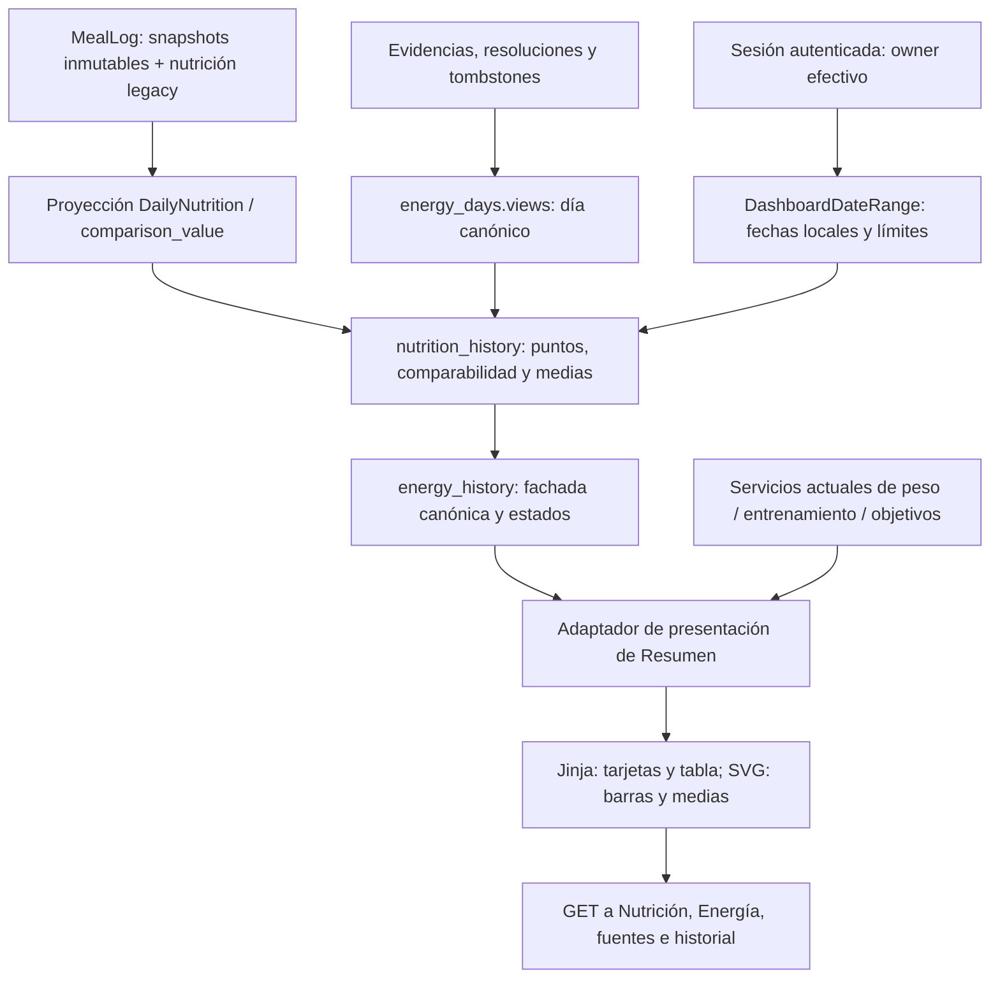

# Resumen de salud unificado — propuesta visual y arquitectura

**Actualización 25-10-2026:** dirección visual aprobada e integrada en `/dashboard` para revisión de PR. [Implementación, diferencias y evidencia Flask real](UNIFIED_HEALTH_SUMMARY_IMPLEMENTATION.md). Tarjetas móviles 2+1, fecha dinámica y navegación Jinja existente. Sin merge/despliegue. El texto siguiente conserva la propuesta original del 24-10 y sus decisiones previas.

24-10-2026. Rama local `codex/unified-health-summary`, basada en master `38c6085565f49f560c9c4a1fefc18356bd1e3000`, creada **después** del [cierre productivo de Energy Experience A+B+C+D](ENERGY_EXPERIENCE_2_0_D_PRODUCTION.md). Sólo diseño, documentación y fixtures de presentación. No hay implementación de rutas/servicios, migración, contrato público nuevo, cambio de flags ni despliegue de esta funcionalidad.

## Dirección visual

[Prototipo interactivo local](../design/unified-health-summary/index.html), [guía y capturas](../design/unified-health-summary/README.md). Se abre desde archivos, sin servidor, CDN ni conexión a una cuenta. El encabezado identifica siempre datos QA ficticios de febrero de 2040.

El primer bloque muestra ingesta, gasto y balance del último día del rango. A continuación, medias móviles de **siete días siempre visibles**, cada una con su denominador, barras diarias conjuntas de ingesta/gasto y un gráfico separado de balance con eje cero. La presentación móvil comienza con los datos; no exige recorrer una navegación extensa. El diseño no presenta déficit/superávit como bueno/malo.

El prototipo permite cambiar 7/30/90 días, tema, cinco estados del día y abrir detalles de presentación. Fecha fija y datos ficticios precalculados: no implementa un calendario productivo, CRUD, acceso a originales ni importación. Las medias de los fixtures se prepararon utilizando la función pura `mean` ya existente en `nutrition_history.py`; el JavaScript sólo selecciona fixtures, formatea y calcula coordenadas SVG. No calcula balances, medias ni totales nutricionales.

## Reutilización canónica

| Necesidad | Autoridad actual | Uso propuesto |
| --- | --- | --- |
| Ingesta y estado parcial | `nutrition_history.history`, `comparison_value` | Usar `values.calories`, `states.calories` y su valor comparable; no sumar comidas en la vista. |
| Gasto total y conflicto | `energy_days.views/view`, expuestos por `energy_history.consultation` | Una proyección canónica por owner/fecha; no sumar evidencias, activas y reposo. |
| Balance diario | `nutrition_history` / `daily_balance` | Consumir el resultado canónico de la pareja válida; no calcular otra versión en Jinja/JS. |
| Medias, calentamiento y denominadores | `nutrition_history` → `energy_history.consultation` | Misma ventana de siete días de calendario, seis días previos de calentamiento, ausencias excluidas y ceros conservados. |
| Estados y procedencia de presentación | `energy_history.field_state`, `day_state`, `field_source` | Conservar conocido/cero/parcial/ausencia/conflicto y enlaces a los dominios existentes. |
| Filtros y otros módulos de Resumen | `DashboardDateRange`, `DashboardSummaryService` | Mantener zona horaria, rangos y comparación; peso, actividad, entrenamiento y objetivos continúan usando sus servicios. |

No cambia el modelo de datos. El diagrama muestra circulación de lectura, no nuevas tablas. Ningún `user_id` del cliente concede autoridad.

## Resolver el rango sin crear otro motor

Actualmente `nutrition_history.history` y `energy_history.consultation` aceptan **7/30/90**, mientras `/dashboard` también admite meses, año y rangos personalizados de hasta 366 días. Además, la media de `NutritionTrendService` empieza en el rango visible; Nutrition/Energía ya incluyen seis días previos. Copiar esa media al nuevo módulo produciría discrepancias en el borde izquierdo.

Decisión propuesta **para revisión antes de implementar**:

1. Extraer la lectura acotada y el bucle existente de Nutrition a un helper interno que reciba inicio/fin y preserve exactamente comparabilidad, calentamiento, medias y denominadores. `history(..., 7/30/90)` seguirá como wrapper compatible; no duplicar su fórmula.
2. Reutilizar ese resultado en una variante acotada de la fachada Energy. Compartir la proyección owner-only de gasto en el mismo contexto de lectura; reutilizar los formateadores de estado existentes. La fachada actual seguirá devolviendo el mismo resultado para 7/30/90.
3. `DashboardSummaryService` adaptará **ese mismo resultado** a tarjetas, series, cobertura de días y tabla. Sustituir la vía energética anterior, no dejarla calculando otra serie. Comparaciones, insights y el snapshot que recibe CoachBrief deberán consumir el mismo bloque canónico. Los otros dominios no cambian de autoridad.
4. Mantener todos los presets, el rango personalizado y la comparación del dashboard; cada período comparado tiene su propio calentamiento y denominadores. No truncar silenciosamente a 30 días ni introducir un segundo selector temporal independiente.

Esta extracción no está implementada en la propuesta. Su gate es la paridad exacta con los resultados actuales de Nutrition/Energía antes de retirar la vía duplicada del dashboard. No añadir cálculos de respaldo para ocultar discrepancias.

## Semántica de producto

- **Completo/conocido:** barras sólidas y balance si ambos valores son comparables. Cero explícito es conocido y participa en la media.
- **Ingesta parcial:** mostrar «Subtotal conocido» y trama; no presentarlo como ingesta total ni déficit. Se excluye de la media de ingesta comparable.
- **Gasto conflictivo:** «Conflicto pendiente», sin elegir la última fuente ni convertirlo en gasto cero. Conservar la ingesta visible; enlace a fuentes/decisiones.
- **Sin dato:** hueco, raya y texto; no interpolar observaciones diarias ni arrastrar el último valor.
- **Medias:** promedio de los valores comparables de su propia ventana. La media del balance usa parejas válidas; **no es la resta de las otras dos medias**. En la semana QA: 2.332 de ingesta (5/7), 2.552 de gasto (5/7), −210 de balance (4/7), aunque 2.332 − 2.552 = −220.
- **Último día vacío:** conservarlo como vacío y ofrecer enlace al último registro propio identificado por el servicio, con su fecha explícita. No sustituirlo silenciosamente por ese registro.
- **Cobertura:** describe disponibilidad/comparabilidad de días, no cumplimiento de objetivos ni completitud nutricional garantizada.
- **Historial:** editar un alimento o receta no recalcula comidas anteriores. No sumar MealLog además de su proyección; no reactivar tombstones ni reescribir fechas por cambiar de zona horaria.

## Integración prevista

La ruta principal seguirá siendo `/dashboard`. Su `?date=...` legado seguirá redirigiendo a `/today`; no se reutilizará para otro significado. El día principal del bloque unificado será el final del rango validado. Los enlaces de detalle llevarán la fecha civil explícita a Nutrición/Energía y conservarán los flujos de confirmación actuales.

Jinja renderizará números, estados y tabla incluso sin JavaScript. La mejora progresiva dibujará sólo geometría con los mismos datos allowlist serializados mediante `tojson`; no exponer ORM, IDs, payloads, firmas o archivos. Respuesta `private, no-store`, sin caché compartida ni almacenamiento local de datos de salud.

No se modifica `/api/v1`, Android/iOS, Mobile Sync, schemas JSON, export/restore o snapshots. No hay nueva persistencia; se espera continuar en 0046. No se activa ningún flag como parte de esta entrega. El módulo debe respetar el flag Nutrition existente y su comportamiento legacy, sin habilitar Nutrition para mostrar la propuesta.

## Gates de una implementación futura

Pruebas focales de paridad con Nutrition/Energía y `daily_balance` para legacy, MealLog proyectado, duplicados de evidencia, contradicción/resolución, retirada, parcial, ausencia y cero; dos propietarios aislados. Verificar primer punto con seis días de calentamiento, límites locales/DST/año bisiesto, rango personalizado, comparación anterior y denominador cero. Inspeccionar que no haya DML ni originales nuevos al consultar.

Reutilizar lecturas acotadas, evitar consultas por día y medir número de consultas/latencia sobre QA sintética. Las tablas no cargarán payloads de eventos ni originales. El trabajo visual futuro tendrá verificaciones proporcionales sobre su propia UI; **esta entrega no repite la campaña de accesibilidad de D** ni afirma certificación WCAG.

Primero revisar esta propuesta. Después, implementación focal, pruebas y PR independiente. No merge o despliegue automático.
